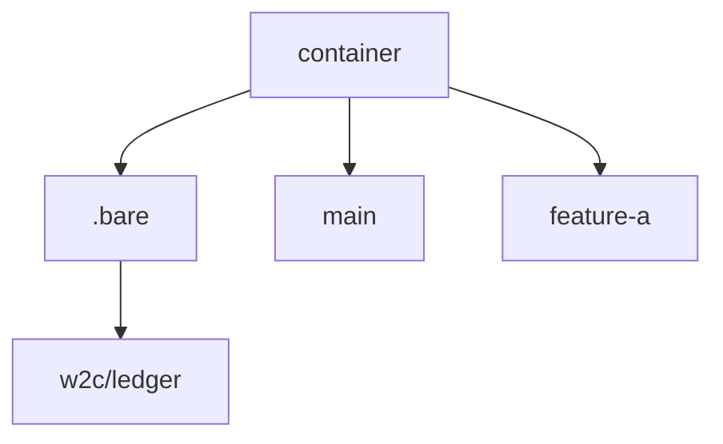

You can keep many branch checkouts side by side by turning the repository into a bare container yourself. W2C will not run these steps and will not offer to convert a checkout during planning. After the container exists, `w2c repo-layout` prints `bare-container` and `w2c worktree-add` creates a sibling directory for the branch.

A bare repository has no working files of its own. `core.bare` must stay true. If you set it to false, Git treats the container as a checkout and lists the other directories as untracked. `info/exclude` does not fix that.

These steps start from a normal checkout and leave a `.bare` directory next to one directory per branch. Run them in a shell, not through W2C.

```bash
git clone --bare <url> .bare
echo "gitdir: ./.bare" > .git
git --git-dir=.bare config core.bare true
git --git-dir=.bare config remote.origin.fetch "+refs/heads/*:refs/remotes/origin/*"
git --git-dir=.bare fetch origin
```

`git clone --bare` sets the fetch line to `+refs/heads/*:refs/heads/*`. That updates local branches and breaks a worktree that has one of those branches checked out. The fetch line above stores remote branches under `refs/remotes/origin/` instead. Then set each branch's upstream the way you usually do, and add a worktree with `git worktree add <branch> <branch>` or with `w2c worktree-add --branch <branch>`.

Git cannot turn the original main checkout into a linked worktree in place. `git worktree remove` refuses the main tree. Leave that checkout as it is, or replace it using the clone above. Do not rewrite history to hide the ledger. The ledger for this layout is `.bare/w2c/ledger`. Git does not commit or push files there.



Worktree operations after this layout exists are in `w2c help worktrees`.
