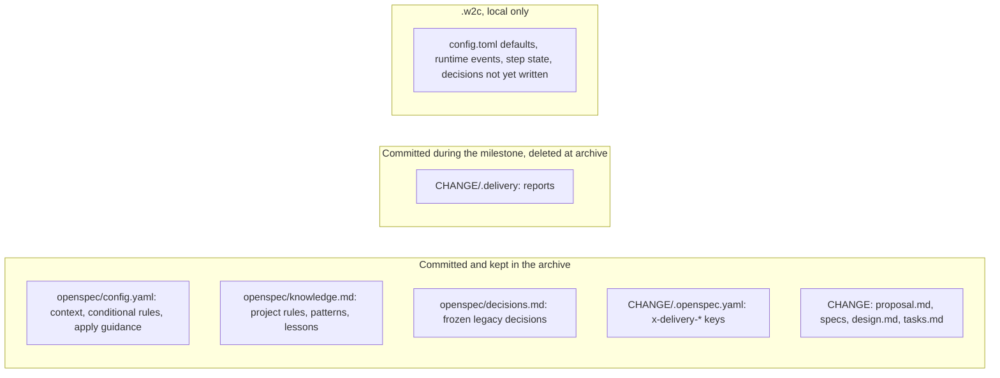

# OpenSpec cloud mode design

After this change you can opt in to a cloud mode that lets an OpenSpec milestone be planned and run from any fresh clone, including a cloud agent session, while the existing 2.2.0 flow stays the default and keeps working unchanged.

Status: approved design, 2026-11-02. Release: 3.0.0, one version for the whole scope. No existing behavior breaks; the owner chose a major version for this release.

## Problem

In OpenSpec planning mode, the OpenSpec change folder (`openspec/changes/<name>/`) is committed, but the W2C milestone files are not. They sit in `.w2c/`, which is gitignored or kept in the Git common directory. A fresh clone, such as a Claude, Copilot, or Cursor cloud session, cannot see the milestone's guardrails, Git Operation Plan, commit conventions, slice plans, status, or reports. So it can neither plan nor run the milestone.

Committing `.w2c/` (the existing `track = true` setting) does not fix this:

- `ROADMAP.md`, `STATE.md`, `QUEUE.md`, and `DECISIONS.md` are shared by every milestone, so parallel branches conflict on merge.
- Milestone ids (`M###`) and decision ids (`D###`) are global counters, so parallel branches allocate the same id.
- Tracking turns off the shared worktree store.

## Requirements

1. The 2.2.0 flow stays the default. Its commands, skills, files, and outputs do not change, except one additive message for a milestone that was moved to cloud mode.
2. Cloud mode is opt-in: `w2c cloud …` commands, `w2c init --planning cloud`, and "work to chores cloud" or "do chores cloud" for the skills.
3. One repo can hold both forms at once, and a milestone planned the 2.2 way can be converted so a cloud agent can run it.
4. Parallel branches, both local worktrees and cloud agents, merge without conflicts in cloud planning or state files.
5. The `.w2c/` directory is never committed.
6. No committed OpenSpec artifact names W2C. A temporary folder that is deleted at archive is allowed.
7. Cloud mode generates no per-milestone planning folder (`.w2c/plans/M###-*/`).
8. Every rule, instruction, guardrail, and operating policy that the 2.2 milestone folder carries lands in the cloud change, and stays there after archive.
9. Cloud mode has no `STATE.md`, `QUEUE.md`, or milestone number (`M###`).
10. The command-line tool (CLI) decides each next step of a cloud run, so an agent cannot drift off the plan.
11. A full-cycle test on a dummy project proves both flows on every change from now on.
12. Cloud agents can get the `w2c` and `openspec` programs and the skills they need.

## Spike results (OpenSpec 1.14.3 and 1.16.0)

| Check | Result |
| --- | --- |
| Extra `design.md` sections pass `openspec validate --strict` | Pass |
| A "Read first" block at the top of `tasks.md` leaves the task list from `openspec instructions apply` unchanged | Pass, 3 of 3 tasks |
| Slice details (goal, demo, must-haves) inside each `## N.` group of `tasks.md` | Pass; apply still lists the same 3 tasks |
| A `.delivery/` folder inside the change is ignored by validation and status | Pass |
| `x-delivery-*` keys in `.openspec.yaml` are accepted | Pass |
| `config.yaml` `context:`, `rules.design`, and `operations.apply.guidance` reach the instructions output | Pass; the apply output contains the guidance and the context |
| `openspec/knowledge.md` and `openspec/decisions.md` at the OpenSpec root are ignored | Pass |
| `design.md` is required before `tasks.md` in the default `spec-driven` schema | Yes |
| `openspec archive` keeps `.delivery/` and the `x-delivery-*` keys unchanged | Yes, so archive cleanup must happen in W2C first |
| A Claude cloud session exposes an environment variable that marks it as temporary | Yes, `CLAUDE_CODE_REMOTE` |
| The `OpenW2C/w2c` repo, `install.sh`, the Python package index, and the npm registry are reachable without credentials from a Claude cloud session | Yes |
| The `OpenW2C/w2c` repo has release tags | No, so a cloud setup can only install `main` today |

## Design

### Opt-in and separation

- All cloud commands live under one group: `w2c cloud <command>`. The existing commands keep their code paths.
- The cloud skills are a separate pair: `work-to-chores-cloud` and `do-chores-cloud`. The 2.2 skills gain one routing line in their description: "Not for cloud mode (use work-to-chores-cloud / do-chores-cloud)".
- `w2c init --planning cloud` makes cloud mode the repo default. The planning values become `openspec`, `classic`, and `cloud`.
- The existing `w2c next`, `complete`, `smoke`, and the other 2.2 commands ignore cloud changes. `w2c cloud` commands ignore 2.2 milestones.

### Where each piece lives

| Rule or state from the 2.2 milestone folder | Cloud home |
| --- | --- |
| Vision, success criteria, in and out of scope, problem and solution | `proposal.md` |
| Delivery & Guardrails table, Git Operation Plan, Base dirt paths, integration strategy | `design.md` → `## Delivery Plan` |
| Guardrails list (verify loop, closeout, no force git, approval gates) | `design.md` → `## Guardrails` |
| Commit and pull-request (PR) conventions | `design.md` → `## Commit and PR Conventions` |
| Slice plans (goal, demo, must-haves, threat surface, proof level, integration closure, verification, files likely touched) | `tasks.md` → the matching `## N.` group, above its tasks |
| Decision Rationale and decision log | `design.md` → `## Decisions` |
| Manual test guide | `design.md` → `## Manual Test Guide` |
| Amendment record | `design.md` → `## Amendments`, appended by the CLI |
| Tasks, Verify lines, done and dropped marks | `tasks.md` |
| Milestone status, order, commit cadence, finished slices, amendment lock, archive decline, former milestone id | `.openspec.yaml` keys `x-delivery-status`, `x-delivery-order`, `x-delivery-cadence`, `x-delivery-slices-done`, `x-delivery-amend-lock`, `x-delivery-amend-prior-status`, `x-delivery-amend-decision`, `x-delivery-archive`, `x-delivery-legacy-id` |
| Task, slice, and milestone reports | `CHANGE/.delivery/` |

Each change file is touched only by its own branch, so parallel branches do not conflict.

### Neutral wording

Committed artifacts state policy without naming the tool. For example, `design.md` says "tick task boxes only through the task-tracking command, never by hand". The cloud skills map each policy to the actual `w2c cloud` command. Artifacts may name the do-chores-cloud skill, because that name does not contain "w2c".

The existing `W2C-OPENSPEC-RULES` marker stays for the 2.2 flow. Cloud mode adds `SLICE-TASK-RULES`, `DELIVERY-SECTIONS-RULES`, and `READ-FIRST`.

### How the rules reach the agent

- `tasks.md` starts with a "Read first" block that names the `design.md` Delivery Plan, Guardrails, and Commit and PR Conventions, says the slice details sit in each task group, and ends: "Run this change only with the do-chores-cloud skill. If it is not available, stop and ask the user."
- `openspec/config.yaml` rules apply to every change in the repo. So each cloud rule starts with "For a change whose `.openspec.yaml` has `x-delivery-status`:". `rules.design` requires the `design.md` sections. `rules.tasks` requires the read-first block, the slice fields, and the task format. `operations.apply.guidance` repeats the pointer and the stop sentence. `context:` points to `openspec/knowledge.md`.
- `w2c cloud brief` prints only what the current task needs.

### Identity, status, and order

- A cloud milestone is its change name. `--change` accepts the change name, or a converted change's `x-delivery-legacy-id`.
- `x-delivery-status` takes `PLANNING`, `TODO`, `INPROGRESS`, `PAUSED`, `STOP`, `ERROR`, or `DONE`. An archived change counts as done. A declined archive is `DONE` plus `x-delivery-archive: declined`.
- Order is `x-delivery-order` when set, then the change name. `w2c cloud new` sets the next order number. The cloud reorder commands only rewrite that key.
- `w2c cloud status` and `w2c cloud next` read the cloud changes on the current branch. `w2c cloud status --all` adds a read-only view of the 2.2 milestones.

### Commit cadence

At plan time the cadence is copied from the local `.w2c/config.toml` `git_delivery` into `x-delivery-cadence`. When no local config exists, as in a cloud session, planning asks for it. Execution reads only the change key.

### Temporary containers

A cloud container can be removed at any time, and a local commit is lost with it. Only a push keeps work.

- `w2c cloud env` prints `ephemeral: true` when `CLAUDE_CODE_REMOTE`, `CODESPACES`, or `GITHUB_ACTIONS` is set. `W2C_EPHEMERAL=1` forces true and `W2C_EPHEMERAL=0` forces false.
- Users of Cursor background agents or Codex cloud set `W2C_EPHEMERAL=1` in that platform's environment settings, because their variables are not confirmed.
- When `ephemeral` is true, do-chores-cloud asks to push after each approved slice commit, as a separate approval.
- The commit and push questions state what a no loses: code, task ticks, and reports.
- Planning warns that milestone cadence is unsafe in a temporary container.

### Reports

do-chores-cloud writes reports into `CHANGE/.delivery/`: `S##-T##-SUMMARY.md`, `S##-UAT.md`, `S##-SUMMARY.md`, `VALIDATION.md`, `SUMMARY.md`. They are committed with the slice or milestone commit. `w2c cloud archive` checks the milestone gates (every slice done, `VALIDATION.md` and `SUMMARY.md` present), deletes `.delivery/`, sets the status to done, and then runs `openspec archive`. `w2c cloud milestone-complete` on an archived change only confirms it. Commit and pull-request text never mentions `.delivery/` or local planner files.

### Decisions

`w2c cloud decide` holds a decision in `.w2c/runtime/` until the change's `design.md` exists. `w2c cloud decisions-flush` then writes the held rows into the `## Decisions` log table. Ids count from `D1` inside each change, so branches cannot collide.

### Project knowledge

`openspec/knowledge.md` holds project rules, patterns, and lessons for cloud mode. A `.gitattributes` line, `openspec/knowledge.md merge=union`, stops append-only edits on parallel branches from conflicting.

### Copilot instruction files

Copilot applies every instruction file to every request, so it can follow one mode per repo. The files follow the repo's default planning mode. `w2c init --planning cloud` writes `plan-work.instructions.md` and `do-work.instructions.md` under `.github/instructions/` from the cloud skills and does not gitignore them. The 2.2 init keeps today's names and ignore lines. These two files name the `w2c` command, because the agent must run it.

### Strict step driver

The CLI, not the agent, decides each next step of a cloud run.

- `w2c cloud step --json` returns exactly one action: `smoke`, `isolate`, `implement`, `verify`, `review`, `write-report`, `complete`, `slice-reports`, `slice-complete`, `milestone-reports`, `ask-commit`, `ask-push`, `ask-archive`, `ask-pr`, `done`, or `stop`. Each action names the change, slice, task, and files. `stop` carries its reason.
- The agent records each finished action with `w2c cloud step --record <action> --result pass|fail|yes|no|no-answer`. A failed `verify` or `review` returns to `implement`.
- Step state lives in each worktree's git directory (`<git-dir>/w2c/step.json`), falling back to `.w2c/runtime/` outside git. A new session that lost it restarts the current task at `implement`, which repeats verify and review rather than skipping them.
- No answer counts as no. When no person can answer a question, the agent records `no-answer` and the driver returns `stop` with the gate name.
- An off-plan request mid-run stops the run and points to an amendment through work-to-chores-cloud.
- do-chores-cloud is a fixed loop: run `step`, do only that action, record it, run `step` again.

### Smoke checks

`w2c cloud smoke` runs these checks on cloud changes only:

| Check | Fails when |
| --- | --- |
| `delivery-keys-valid` | an `x-delivery-*` key holds a value outside its allowed set |
| `design-sections` | a required `design.md` section is missing |
| `git-operation-plan` | the Delivery Plan breaks today's Git Operation Plan rules |
| `commit-pr-conventions` | the conventions lack a Co-authored-by ban, a stage ban, a mention ban naming `.delivery/`, or the product-content sentence |
| `manual-test-guide` | the field is not `yes` or `no`, or `yes` has an empty section |
| `slice-fields` | a task group lacks one of the eight slice fields |
| `read-first-present` | `tasks.md` lacks the read-first block or its stop sentence |
| `ticked-without-report` | a `tasks.md` box is ticked but its report is missing from `.delivery/` |
| `closeout-reports` | a finished slice or milestone lacks its reports |
| `neutral-artifacts` | "w2c" appears anywhere in a change folder |
| `unique-change-ids` | two changes share one former milestone id |

The OpenSpec checks for strict validation, artifact completion, Verify lines, progress agreement, and archive-when-done also run on cloud changes.

### Cloud access

- Claude Code cloud and Codex cloud install the programs in the environment's setup script. GitHub Copilot uses `.github/workflows/copilot-setup-steps.yml`. Cursor uses `.cursor/environment.json`. These setup files may name `w2c`.
- `docs/cloud-sessions.md` gives the exact snippet for each platform.
- Releases are tagged, starting with `v3.0.0`, and `install.sh --ref <tag>` installs a pinned version.
- When `w2c` is missing, the cloud skills offer, after asking, to run it on demand with `uvx --from git+https://github.com/OpenW2C/w2c@<tag> w2c`.
- When a companion skill (grilling, brainstorming, requesting-code-review) is missing, as on Copilot or Cursor, the cloud skills follow written fallback rules instead of stopping.

## Mixed repos and conversion

### Both forms in one repo

| Concern | Rule |
| --- | --- |
| Queues | Separate. `w2c next` sees only 2.2 milestones; `w2c cloud next` sees only cloud changes. |
| Milestone ids | 2.2 keeps `M###`. A converted milestone keeps its plan folder in `.w2c/plans/` with a `CONVERTED` marker file, so the id is never reused. |
| `DECISIONS.md` | Stays append-only. Conversion copies rows and removes none. |
| CONTEXT and knowledge | 2.2 keeps `CONTEXTvX.Y.md`. Conversion adds missing rows from the latest CONTEXT to `openspec/knowledge.md`, compared by row text. Nothing flows back. |
| `git_delivery`, `DELIVERY-PROFILE.md` | Stay local for 2.2. Conversion copies them into the change. |
| `STATE.md`, `QUEUE.md`, `ROADMAP.md` | Kept while any 2.2 milestone remains. Conversion removes that milestone's `ROADMAP.md` line and rebuilds the other two. |

### `w2c cloud migrate`

1. `--milestone M###` (repeatable) converts named milestones. `--all` converts every OpenSpec milestone. `--dry-run` prints every action. `--restore` undoes the last run before it is committed.
2. It refuses a classic milestone and points to re-planning with "work to chores cloud". It refuses a milestone whose paths hold uncommitted changes, and a branch that is not checked out anywhere.
3. Before acting, it checks that OpenSpec is installed, then backs up `.w2c/` and every target file.
4. For each milestone it writes the keys, including `x-delivery-legacy-id`, and renames `x-w2c-milestone` to that key. A finished milestone gets only the keys.
5. For an unfinished milestone it copies every rule section verbatim into the `design.md` sections and every slice plan detail into the matching `tasks.md` group, checks each section by fingerprint, copies existing reports into `.delivery/`, and copies an active amendment lock.
6. It copies the milestone's `DECISIONS.md` rows into the change's `## Decisions` log with their original ids.
7. It syncs `openspec/knowledge.md`, and on first use adds the `.gitattributes` line and the conditional `config.yaml` rules. Editing `config.yaml` needs its own approval.
8. A known legacy template line that names W2C is rewritten to its neutral form only with approval. An unknown line is never rewritten; it is listed for a manual edit.
9. It marks the plan folder `CONVERTED`, removes the `ROADMAP.md` line, and rebuilds `STATE.md` and `QUEUE.md`.
10. With `--all` and no 2.2 milestone left, it writes the remaining `DECISIONS.md` rows to a frozen `openspec/decisions.md` and deletes `STATE.md`, `QUEUE.md`, `ROADMAP.md`, `DECISIONS.md`, and `contexts/`.
11. Afterwards it confirms that cloud smoke passes and that `w2c cloud next` returns the same task the 2.2 `next` returned before.
12. It never commits. It prints the paths to commit for each branch.

After conversion, the 2.2 `w2c next --milestone M###` prints `CLOUD_MOVED M### <change>`. That is the only change to a 2.2 code path. There is no conversion from cloud back to 2.2.

### Running a locally planned milestone in the cloud

1. Locally, run `w2c cloud migrate --milestone M004 --dry-run`, then the same command without `--dry-run`.
2. Commit and push the change folder, with approval.
3. In the cloud, "do chores cloud" runs do-chores-cloud on that branch.

## Full-cycle test

- `scripts/w2c-e2e.py --suite legacy|cloud|all` builds a dummy project (a small Python app, a git repo, and a local bare repo as its remote) in a temporary folder, installs W2C with `install.sh`, and runs every stage with the real OpenSpec program.
- The legacy suite covers today's flow: install, init, planning, base dirt, worktree, execution gates, hooks, amendment, closeout, classic mode, and skill trials. Its stored expected outputs must not change in this release.
- The cloud suite covers cloud init, planning from templates, decisions, reorder, execution driven only by `w2c cloud step`, a fresh-clone run with no `.w2c/` and `W2C_EPHEMERAL=1`, amendment, closeout and archive, the neutral-naming rule, a mixed repo with one converted milestone, and full conversion with restore.
- Each run writes a checklist with one `- [x]` or `- [ ]` line per stage, ending in `E2E: PASS` or `E2E: FAIL`.
- Continuous integration (CI) runs `--suite all` against OpenSpec 1.14.3 and 1.16.0. A missing OpenSpec program fails the run.
- `AGENTS.md` requires every change to pass the full-cycle test, and requires a change that alters behavior to update the scenario in the same change. A pull-request template box points to the CI result. Making the CI check required on `main` is a GitHub branch-protection setting the repo owner turns on.
- The test cannot prove an agent obeys a skill; `w2c trials` covers skill text.

## Accepted compromises

| Id | Compromise |
| --- | --- |
| C1 | `openspec/config.yaml` rules apply repo-wide, so in a mixed repo 2.2 agents also read the conditional cloud rules. |
| C2 | Two skill pairs duplicate shared rules. A trials check keeps every shared guardrail group in both pairs. The 2.2 skills gain one routing line. |
| C3 | Users learn two command sets: `w2c …` and `w2c cloud …`. |
| C4 | Copilot follows one mode per repo, the repo's default. |
| C5 | The pre-push archive hook and `base-dirt` gain additive cloud checks; the legacy suite proves 2.2 behavior is unchanged. |

## Delivery phases

| Phase | Output |
| --- | --- |
| 0 | Full-cycle test harness, the legacy suite, the CI job |
| 1–4 | Cloud package: change keys, the `w2c cloud` group and `env`, templates and conditional config rules, artifact checks |
| 5–9 | Cloud commands, decisions and knowledge, amendments, smoke and shared hooks, the step driver and `brief` |
| 10–12 | Copilot files for cloud init, conversion planner, conversion apply and restore |
| 13–14 | Cloud skills and trials, the 2.2 routing lines, cloud access docs and `install.sh --ref` |
| 15 | Release 3.0.0, the `AGENTS.md` rule, the pull-request template |

Each phase extends the cloud suite of the full-cycle test.

## Risks

- Work in a temporary container is lost when the user declines a commit or a push. The `env` check, the push question after each slice, and the plain loss wording reduce this, but every commit and push still needs approval.
- The environment variable for Cursor background agents and Codex cloud is not confirmed. `W2C_EPHEMERAL=1` covers them.
- In a mixed repo a person may run the wrong skill for a milestone. `CLOUD_MOVED` and the separate command groups catch this; hand edits are not caught.
- After a conversion, project knowledge has two homes: CONTEXT for 2.2 work and `knowledge.md` for cloud work.
