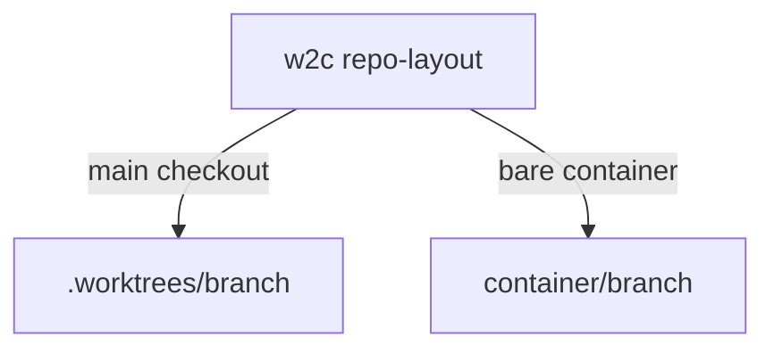

You can run more than one ticket at the same time. Each ticket gets its own worktree (a separate checkout of one branch), and they share one ledger that Git does not commit or push.

A ledger is the W2C planning files under `.w2c/`. When `track` is false (the default in `.w2c/config.toml`), those files live in the Git common directory at `<git-common-dir>/w2c/ledger`. Every worktree of the repository uses that same directory. `git status` and `git ls-files` do not list it. `track = true` keeps a normal `.w2c` directory in the branch and does not use this store.

## What W2C detects

`w2c repo-layout` prints one of two layouts. It does not ask you to convert the repository.

| Layout | How you can recognize it | Where the next worktree goes |
| --- | --- | --- |
| main-checkout | One checkout contains the `.git` directory | `<checkout>/.worktrees/<branch>` |
| bare-container | The Git directory is a sibling, often `.bare`, and no checkout sits on that parent | `<container>/<branch>` |

A branch name with slashes becomes nested directories. `feature/login` is `.worktrees/feature/login` on a main checkout. W2C rejects `..` and an absolute path. It will not create a worktree inside a worktree you already have. If the ticket branch is checked out in the main checkout, switch that checkout to another branch first. One branch can be checked out in only one place.



## Exclude line

On a main checkout, Git would otherwise show `.worktrees/` as untracked. W2C can append `.worktrees/` to Git's local exclude file (`<git-common-dir>/info/exclude`). That file is local. It is not committed. Planning asks this once, and only when the line is missing. The default is yes. No still creates the worktree. A bare container does not get this question. W2C does not add a new `.gitignore` line for this.

## Create and remove

`w2c worktree-add --branch <name>` creates the directory from the detected layout, or reuses it when that branch is already checked out there. `--create-from HEAD` creates the branch from the current commit without checking it out in the checkout you are in. `--exclude yes` is the default. `--exclude no` leaves `info/exclude` unchanged.

`w2c worktree-remove --branch <name>` asks first. It copies that ticket's plan files back to the store, then removes the worktree only when the tree is clean. It does not use `--force`. It does not delete the branch or the store. Ignored files other than the ledger projection, such as `node_modules`, still count as dirty to Git. The command stops and shows that error.

`git worktree prune` does not delete the directory. `git clean -xdf` from the main checkout deletes ignored `.worktrees/` and the checkouts inside it. Do not run that against a checkout that holds worktrees.

## Local files (env and secrets)

Git worktrees do not copy gitignored files such as `.env`. List relative paths in `.w2c/config.toml` as `worktree_seed`. An empty list (or omitting the key) turns seeding off.

```toml
worktree_seed = [
  ".env",
  ".envrc.local",
  "apps/app-v2/.env",
]
```

`w2c worktree-add` and `w2c worktree-seed` create **symlinks** from the main checkout file into the worktree. They never overwrite an existing file or a wrong symlink. A missing source file prints `seed-skip missing-source` and is skipped.

`w2c worktree-seed --check` exits non-zero when a configured path has a source on the main checkout but is missing or wrong in the current checkout. Agents run this after isolation and may run `w2c worktree-seed` once to repair.

`w2c worktree-seed --suggest` prints common env file candidates under the seed source checkout. On a new `w2c init` with a terminal, W2C may ask whether to store those candidates as `worktree_seed`.

## How the ledger stays in step

## How the ledger stays in step

The `w2c` command does this. Git does not merge these files, and the agent should not copy them by hand.

The main checkout's `.w2c` is a relative symlink (a pointer) to the store. A linked worktree gets a real `.w2c` directory, because many editors cannot follow a symlink that leaves the worktree. `worktree_ledger = symlink` keeps the pointer instead. `copy` takes one snapshot. New projects use `materialize`, which is the full sync below. An existing config that already says `symlink` stays a pointer.

At the start of a `w2c` command in a linked worktree, the command copies that branch's milestone folder up to the store, then copies shared files and other milestones down. At the end it copies that branch's folder and the shared files back up. Shared files are `STATE.md`, `QUEUE.md`, `ROADMAP.md`, `DECISIONS.md`, `contexts/`, `config.toml`, `DELIVERY-PROFILE.md`, and `runtime/`. The milestone folder is the one whose Git Operation Plan remote branch equals the current branch.

After the command finishes, the main symlink shows the same files. Edit that milestone in its worktree once the worktree exists. The next `w2c` command copies the worktree's copy over the store. A crash between an edit and the next command leaves the edit only in that worktree.

OpenSpec change files under `openspec/` are product files. They are committed. The ledger is not.

For a bare container you set up yourself, read `w2c help bare-container`. W2C does not run those steps.
