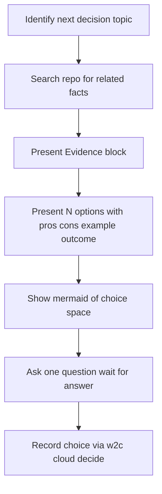

# Work to Chores (cloud)

Requires: w2c >= 3.2.0

**Plan only.** Interview, review, plan, validate, then write one OpenSpec change. Never implement product code.

Read `USAGE.md` in this folder for the plain-English invocation.

Cloud mode keeps the whole plan in the repository, so a fresh clone or a temporary container can run it. The plan is `openspec/changes/<name>/`: `proposal.md`, `specs/`, `design.md` (six delivery sections), and `tasks.md` (read-first block, then one `## N.` group per slice). Closeout reports go in that change's `.delivery/` folder. Only runtime files live under `.w2c/runtime/` (and the step state in the git directory), and they are never committed.

Committed change files (everything under `openspec/changes/<name>/`) and the `.delivery/` reports must never contain the word "w2c", in any case, or a `.w2c/` path. Say "local planner files" instead.

## Prerequisites (hard stop)

Before Stage 1:

1. Confirm `w2c` is on PATH (`command -v w2c`) and `w2c --version` is 3.2.0 or later. Do this first: every later step, including each `w2c event` log line, needs it. If it is missing, follow the uvx paragraph below before any other step, and log nothing until `w2c` (or the uvx prefix) works.
2. Check whether **grilling** and **brainstorming** are invocable. If either is missing (for example on Copilot or Cursor), follow **Missing companion skills (ask first)** below.
3. Run `w2c openspec-check`. If `needs` contains `NEED_OPENSPEC_INSTALL` or `NEED_OPENSPEC_INIT`, follow **OpenSpec install (ask first)**.

If `w2c` is missing or older than 3.2.0: ask the user whether to run it once through uvx. On yes, use this prefix for every `w2c` command in this run:

```bash
uvx --from git+https://github.com/OpenW2C/w2c@v3.2.0 w2c …
```

On no: **STOP**. Tell the user to install it (`pipx install git+https://github.com/OpenW2C/w2c.git && w2c install-skills`) and re-invoke this skill. Never run uvx without that yes.

Run `w2c cloud env`. Keep its `ephemeral:` line for the cadence question in Stage 3.

### Missing companion skills (ask first)

Run `w2c cloud env` and read its `agent:` and `ephemeral:` lines. Ask one question for every missing companion together, not one per skill, and wait for the answer:

```text
These companion skills are not installed here: <names>. Without them I use the written fallback in this skill.
(a) Stop now so you can install them, then run this skill again. [recommended when agent is claude-code and ephemeral is false]
(b) Continue with the written fallback. [recommended otherwise]
```

`<names>` lists the missing skills (grilling, brainstorming, or both). Mark (a) `[recommended]` when `agent:` is `claude-code` and `ephemeral:` is `false`, and (b) otherwise: in a temporary container a plugin installed during the session is lost with it.

- **(a):** run `w2c help companions` and show the user only the section named by `agent:`, or every section when it is `unknown`. Never write install steps that this command does not print. Log `w2c event --skill work-to-chores-cloud --stage prereq --event stop --detail "install <names>"` and **STOP**.
- **(b):** follow **Companion fallback** for each missing skill. Log `w2c event --skill work-to-chores-cloud --stage prereq --event retry --detail "fallback <names>"`.
- **No answer:** when the run cannot wait for an answer, take (b). Never claim that a missing skill ran.

### OpenSpec install (ask first)

If `w2c openspec-check` reports `NEED_OPENSPEC_INSTALL` or `NEED_OPENSPEC_INIT`, stop and ask the user before changing the machine or the project. On no: stop. On yes, follow this prompt and stop where it tells you to stop:

```text
Fetch https://raw.githubusercontent.com/Fission-AI/OpenSpec/main/install.md and follow it.
```

That prompt's own stops still apply: confirm before installing, no sudo, never edit shell startup files, and list what `openspec init` will delete before it runs. Re-run `w2c openspec-check` afterwards.

### Cloud rules in `openspec/config.yaml` (ask first)

Read `openspec/config.yaml`. The cloud rules are present when it contains `DELIVERY-SECTIONS-RULES`, `SLICE-TASK-RULES`, and `READ-FIRST`. If any is missing, run `w2c cloud rules`, show the user its output (the snippet to merge), and ask before adding it. On yes, merge it: add the lines under the existing `context:`, `rules:` (`design`, `tasks`) and `operations:` (`apply.guidance`) keys. Never write a second `context:`, `rules:`, or `operations:` key, and never remove a line that is already there. On no, continue, and say that OpenSpec's own instructions will not carry the delivery rules.

## Companion fallback

Use this section only for a companion skill that is missing. Do not use it when the skill is installed.

- **grilling or brainstorming missing:** run that pass yourself with the **Interview question contract** below, word for word: one question at a time, Evidence block first, options with pros, cons, example and possible outcome, one `[recommended]`, one mermaid diagram, wait for the answer, save with `w2c cloud decide`. Grilling closes when scope, users, done criteria, risks, integrations, and out-of-scope are clear. Brainstorming looks for structural gaps: edge cases, empty states, error paths, testing seams.
- Use this section only after the user chose (b), or the run could not wait for an answer.

## Status writes

Use the CLI only for task checkboxes, change status, the run order, the Decisions table, and the Amendments section:

```bash
w2c cloud env
w2c cloud rules          # prints the openspec/config.yaml snippet
w2c cloud new --slug <name> [--cadence slice-commit-milestone-push-pr|milestone-commit-milestone-push-pr]
w2c cloud template <name>   # design, read-first, slice-group, task-summary, slice-uat, slice-summary, validation, summary
w2c cloud decide [--change <name>] --scope ... --decision ... --choice ... --rationale ...
w2c cloud decisions-flush --change <name>
w2c cloud status          # add --all to also print a local 2.2 .w2c/STATE.md
w2c cloud status-set <name> PLANNING|TODO|PAUSED|STOP|ERROR
w2c cloud order <name> <name> ...
w2c cloud swap <left> <right>
w2c cloud move <name> --before <other>   # or --after <other>
w2c cloud smoke --change <name>
```

Never hand-edit `x-delivery-*` keys in `.openspec.yaml`, `[ ]` / `[x]` in `tasks.md`, the `## Decisions` table, or the `## Amendments` section. Authoring plan prose (proposal, specs, design text, slice fields, tasks, Verify lines) is allowed after Stage 5 approval.

## Events (local only)

Append-only JSONL at `.w2c/runtime/events.jsonl`. Never commit it. Never hand-edit it.

```bash
w2c event --skill work-to-chores-cloud --stage STAGE --event EVENT [--detail "..."]
```

`--event` is one of: `started`, `complete`, `pass`, `fail`, `stop`, `retry`. Log at every stage enter and exit and every hard stop.

## Interview question contract

Use this contract for **every** grilling and brainstorming question in Stages 1–3 (including Stage 2 gap resolution). One question at a time. Wait for an answer before the next.



### Evidence block (mandatory before the question)

Search the project for facts related to this decision. Present them **before** asking:

- What was searched (files, symbols, patterns)
- Facts found (tables OK): current implementation, call sites, related patterns, edge cases, absences
- How that evidence shapes the options

Evidence includes `openspec list --specs` and `openspec show <id> --type spec` before you name a capability. Do not ask the user for a fact you can look up in the repo.

### Options block (flexible count)

Always mark one option `[recommended]`. Target ~4 meaningful options when the decision is open-ended, fewer when it is naturally narrow, more when evidence shows more real approaches. Never invent filler or illegal options.

For **each** option, in simple English: what it means, **Pros**, **Cons**, **Example**, **Possible outcome**. Include **one mermaid diagram** that compares the options.

### After the answer

Save with `w2c cloud decide`. Before the change exists, leave out `--change`: the command prints `PENDING` and holds the row under `.w2c/runtime/`. After `w2c cloud new`, run `w2c cloud decisions-flush --change <name>` once, so every held row lands in that change's `## Decisions` table. Keep the rich write-up (why, pros, cons, outcome, diagram) for the Decisions section prose at write time.

## Reorder pending changes (no new plan)

If the user asks to reorder, swap, or change which pending change runs next, and they are not bringing new work, do **not** start Stage 1.

1. Run `w2c cloud status` and show the run order (name, status). In a repo that also has 2.2 milestones, run `w2c cloud status --all` so the user sees both. That is the Evidence block.
2. Grill one placement question with the interview contract. Recommended when they named no target: leave the order unchanged. Real choices: `w2c cloud move <name> --before|--after <other>`, `w2c cloud swap`, or `w2c cloud order` with the full list.
3. Refuse a placement that moves ahead of or swaps with an `INPROGRESS` change. The way through is `w2c cloud status-set <name> PAUSED`, `STOP`, or `ERROR`, then reorder.
4. Run the matching command. Do not hand-edit `x-delivery-order`.
5. `w2c cloud decide --scope <names> --decision "execution order" --choice "<resulting order>" --rationale "<why>"`.
6. `w2c cloud smoke --change <name>` for each change whose position changed.

Then stop. Do not write product code.

## Amend an unfinished change (no new plan)

If the user wants to drop, change, or add open work in a change that already exists, do not start Stage 1. Allowed statuses are `PLANNING`, `TODO`, `PAUSED`, and `INPROGRESS`. Refused: `DONE`, `STOP`, `ERROR`, and any archived change.

1. Show which tasks are finished (`w2c cloud status`, ticked boxes in `tasks.md`). Do not drop a finished task, a slice with a finished task, or behavior a finished task already implemented.
2. Propose one batch: each drop, edit, or add, with the reason. For a drop, ask whether anything must be picked up later. If yes, show what was dropped, why, and what is left, and ask either to allow ticket creation (the user names the tracker) or to create the ticket themselves. `w2c` does not call a tracker.
3. Wait for one approval of the whole batch. On no, revise and ask again. Do not run `amend-begin` before that yes.
4. After the yes, record one `w2c cloud decide --change <name>` row.
5. `w2c cloud amend-begin --change <name> --decision D###`. An `INPROGRESS` change pauses and gets the amendment lock, so do-chores-cloud stops with `AMEND_LOCK`.
6. Apply only the approved commands, each citing that decision: `w2c cloud drop-task`, `drop-slice`, `task-add`, `task-edit`, `slice-add` (all with `--change <name>`). Append ids; never renumber. A new slice from `slice-add` has empty slice fields: fill all eight before smoke.
7. After that same approval you may edit the proposal, specs, and design prose. Run `openspec validate <name> --strict`.
8. `w2c cloud smoke --change <name>`. On failure the lock stays. On success `w2c cloud amend-end --change <name>`. Show `w2c cloud amendments --change <name>`.
9. `w2c cloud follow-up --change <name> --slice S## [--task T##] --ticket <link>` sets the ticket link later. The reason text stays fixed.

Then stop. Do not write product code.

## Convert a 2.2 milestone ("convert M###")

When the user says `convert M###` (or names several), do not start Stage 1.

1. Run `w2c cloud migrate --milestone M### --dry-run`. It writes nothing. Show its full output to the user.
2. Ask before the real run. On no, stop.
3. If the dry run names an `openspec/config.yaml` edit, ask separately before passing `--yes-config`. If it names known line rewrites, ask separately before passing `--yes-rewrites`. Pass each flag only after its own yes.
4. Run `w2c cloud migrate --milestone M###` with only the approved flags. It never commits.
5. Run `w2c cloud smoke --change <name>` for each converted change and show the result. Show `w2c cloud status --all` so the user sees the cloud changes next to any 2.2 milestones left.
6. `w2c cloud migrate --restore` undoes the last run exactly. Offer it if the user is unhappy with the result. Never use `--all` unless the user asked for every milestone.

Do not commit the result from this step. Tell the user to review the diff and run do-chores-cloud.

## Stage 1 - Gather context

Always run this stage, even when a ticket or spec is pasted. Need a hint of the work; if there is none, ask for one.

In order, each question following the **Interview question contract**:

1. **Grilling** — until scope, users, done criteria, risks, integrations, and out-of-scope are clear.
2. **Brainstorming** — structural gaps (edge cases, empty states, testing seams).
3. **Grilling again** — confirm each gap and pick a solution.

Record decisions with `w2c cloud decide`.

## Stage 2 - Review context

Review collected knowledge for architectural or design gaps that would break the original requirement. If you find one, say what is wrong and its impact, then ask with the interview contract. Save the choice and return to Stage 1.

## Stage 3 - Plan

One piece of work is one change (`<name>` is a short kebab-case slug). Each `## N.` group in `tasks.md` is a slice. Each task is `- [ ] N.M <title>` with an indented `- Verify: <command>` line. Grill one capabilities question: which capabilities are new, which existing ones change, or none when behavior does not change.

Embed this execution rule (do **not** execute it here): a task is not complete until Verify passes and **requesting-code-review** is clean; after a group's last task re-run its Verify lines, write the slice UAT and summary, complete the slice; after the last group write `VALIDATION.md` and `SUMMARY.md`, commit them (after a yes), archive, then commit the archive move (after a yes). When the archive is declined, the change is committed but not pushed: the push check refuses a finished change until it is archived.

The `.delivery/` reports reach git history only through commits: each slice commit carries the reports present then, the milestone commit before the archive carries `VALIDATION.md`, `SUMMARY.md`, and any report not yet committed, and `w2c cloud archive` then removes `.delivery/`, so the commit after the archive carries only the move.

### Commit cadence (required grilling)

Read `git_delivery` from `.w2c/config.toml` if it exists. If there is no local config, grill the cadence and pass it to `w2c cloud new --cadence`: `slice-commit-milestone-push-pr` (commit after each slice) or `milestone-commit-milestone-push-pr` (commit once at the end).

When `w2c cloud env` printed `ephemeral: true`, warn before the question: this is a temporary container, so work that is not pushed is lost when it ends. Milestone cadence is unsafe here because nothing is committed until the end. Mark slice cadence `[recommended]`; with it, do-chores-cloud asks to push after each slice commit except the last one, whose push the end-of-change asks cover.

### Git isolation (required grilling — one question at a time)

Only two modes exist: `worktree` or `branch`.

1. **Isolation mode** — worktree (a separate directory created later by `w2c worktree-add`) or branch (same checkout, switch to the ticket branch). If `worktree`, run `w2c repo-layout` and record the layout (see **Worktree layout and Exclude line** below). Do not offer to convert the repository.
2. **Branch name** — Local branch **must equal** Remote branch. With a ticket id (e.g. `MOR-252`) propose that exact id. Without one, propose 2–3 slugs plus custom.
3. **Base dirt policy** — only after Isolation mode is saved.
   - `worktree`: do not ask. Choice `n/a-worktree`.
   - `branch`: run `w2c base-dirt`. Non-zero exit: **STOP** and show the error.
     - `status` `clean`: do not ask. Choice `clean-at-plan`.
     - `status` `noncritical`: ask the option question. **Leave untouched** is `[recommended]`.
     - `status` `critical`: this turn is a warning only. List every `critical` path, say they will ride into the ticket checkout as uncommitted changes and can be committed by mistake, include `note` when non-empty, and do **not** show options. If the user answers with an option on this turn, reject it and repeat the warning. Only after they explicitly ask to see the choices, ask the option question with **Pause and clean** `[recommended]`.

   Options, in this order: 1. **Leave untouched** (`leave-untouched`; later product commits never stage those paths), 2. **Pause and clean** (`pause-and-clean`; re-run `w2c base-dirt` after), 3. **Pause for the base branch** (`pause-for-base`), 4. **Abort branch setup** (`abort-branch-setup`). Pause and abort are not `Base dirt policy` values; record them with `w2c cloud decide` only.

   For `leave-untouched`, write `### Base dirt paths` (Critical and Other lists from the scan, `(none)` when empty) under the Delivery Plan table.

#### Worktree layout and Exclude line

When Isolation mode is `worktree`, after `w2c repo-layout`:

- Write `Worktree layout` and `Worktree dir` from that output. There is no yes/no question for the layout.
- If `exclude` is `missing`, ask once whether to add the worktree directory to Git's local exclude file (`info/exclude`). Default is yes. Record `exclude-yes`, `exclude-no`, or `already-set` with `w2c cloud decide` and in the Exclude line. A bare container prints `exclude: n/a`; do not ask.
- Do not create the worktree in this step. The plan-commit gate creates it.

When Isolation mode is `branch`, write `n/a` in Worktree skill, Worktree layout, Worktree dir, and Exclude line.

### Delivery profile (optional — no hard stop)

After the cadence question, read `.w2c/DELIVERY-PROFILE.md` if present:

- Copy **Integration strategy** and **Integration branch (day-to-day)** (and **Production branch** when the strategy is `gitflow`) into the Delivery Plan rows `Integration strategy`, `Integration branch`, and `Production branch`.
- If the file is **missing**: keep the template value `(from the project's delivery profile)` in Integration strategy, write `none` in Integration branch and Production branch, and continue. Do **not** stop.
- Never write the profile's path, a `.w2c/` path, or the word "w2c" into `design.md`: it is a committed change file.

### Delivery Plan values

Every row of `## Delivery Plan` gets one of these values:

| Field | Value |
| --- | --- |
| Isolation mode | `worktree` or `branch` |
| Local branch | ticket id or confirmed slug |
| Remote branch | **must equal** Local branch |
| Isolation scope | `ticket` |
| Setup when | `first-task` |
| Reuse policy | `reuse-if-same-ticket-else-stop` |
| Worktree skill | `using-git-worktrees` if mode is `worktree`; `n/a` if `branch` |
| Worktree layout | `main-checkout` or `bare-container` from `w2c repo-layout` when mode is `worktree`; `n/a` if `branch` |
| Worktree dir | the directory from `w2c repo-layout` when mode is `worktree`; `n/a` if `branch` |
| Exclude line | `exclude-yes`, `exclude-no`, `already-set`, or `n/a` |
| Push rule | from the change's x-delivery-cadence key plus explicit approval; push ref must equal Remote branch |
| Base dirt policy | `n/a-worktree`, `clean-at-plan`, or `leave-untouched` |
| Integration strategy | from the delivery profile, or `(from the project's delivery profile)` when there is none |
| Integration branch | from the delivery profile (day-to-day), or `none` |
| Production branch | from the delivery profile when the strategy is `gitflow`, or `none` |

Keep the `Isolation scope`, `Setup when`, `Reuse policy`, and `Push rule` values exactly as `w2c cloud new` wrote them. Every other row gets a value or `none`.

### Commit and PR conventions (required)

Inspect the repo: `CONTRIBUTING*`, `.github/*PULL_REQUEST_TEMPLATE*`, recent `git log` titles and bodies, `.gitignore`. Then fill `## Commit and PR Conventions` in the `design.md` that `w2c cloud new` wrote:

- Keep every line of the section that does not start with `Planner:` exactly as written. Do not reword, drop, or reorder them.
- Put the value on the same line after **Commit title:**, **Commit body:**, and **Pull request:**, from what this repo actually uses.
- Delete the first `Planner:` line (the one that says to inspect this repo).
- Replace the `Planner:` line under **Do not stage / commit:** with one line: `Never stage: local planner files, ` followed by the notable `.gitignore` paths (such as `.env*`) and any `### Base dirt paths`. Write "local planner files" for the planner's own files: never write `.w2c/` or the word "w2c" into committed text.
- Keep the product-content line exactly: "`openspec/` is product content and is never deny-listed. Product commits stage only this change's folder plus the archive result." The change's `.delivery/` reports are product content too and are never deny-listed.
- Keep **Do not mention:** (never name a `.delivery/` path, closeout report, or local planner file in commit or pull-request text) and **AI attribution — forbidden:** (no `Co-authored-by:` trailers or similar AI co-author lines) as written.

Do not leave TBD.

### Manual test guide (required grilling)

Ask: "Do you want a step-by-step manual test guide for this change, to run after it is done?" Recommended **yes** when user-visible behavior changes, **no** for docs or infra. Set the Delivery Plan row `Manual test guide` and, on yes, fill `## Manual Test Guide` with numbered steps and expected results. It is never a completeness gate.

## Stage 4 - Validate the plan

Loop Stages 1–4 until no gap is left. Confirm: one isolation mode and branch across the ticket, cadence chosen, every Delivery Plan row has a value or `none`, conventions filled with the Co-authored-by ban, manual test answered, every slice has all eight fields, every task has a Verify line.

## Stage 5 - User review

Ask the user to review the plan (isolation, branch, cadence, slices, decisions). A requested change is checked against the original requirement first. If it fits, restate it, wait for confirmation, and go back to Stage 1. If not, explain the mismatch and do not change the plan. Do not write files before approval.

## Write the change (after approval only)

1. `w2c cloud new --slug <name>` (add `--cadence <value>` when no local config exists or it printed `NEED_CADENCE`). This creates `openspec/changes/<name>/` with the `x-delivery-*` keys and writes two files, each only when it is absent: `design.md` (the six delivery sections, from the cloud design template) and `tasks.md` (starting with the read-first block). It writes nothing else.
2. `w2c cloud decisions-flush --change <name>`.
3. For each artifact, run `openspec instructions <artifact> --change <name> --json` and write the file it names. Order: proposal, specs, design, tasks. For `design.md` and `tasks.md`, fill the files `w2c cloud new` wrote: never replace them. `w2c cloud template design` and `w2c cloud template read-first` print the same text again if one was lost.
4. **`design.md`** must contain these six required sections, in this order, as `w2c cloud new` wrote them. After `openspec instructions design`, put OpenSpec's own design sections (Context, Goals / Non-Goals, Risks / Trade-offs, Migration Plan, Open Questions) after `## Amendments`. Never remove or rename the six:
   - `## Delivery Plan` — every row filled (value or `none`): Isolation mode, Local branch, Remote branch, Isolation scope `ticket`, Setup when `first-task`, Reuse policy, Worktree skill, Worktree layout, Worktree dir, Exclude line, Push rule, Base dirt policy, External ticket ID, Integration strategy, Integration branch, Production branch, Review unit, Execution sequence, Validation commands, Completion condition, Size budget (LOC diff), Manual test guide. Plus `### Base dirt paths` for `leave-untouched`.
   - `## Guardrails` — the template's guardrails, verbatim. Do not edit them.
   - `## Commit and PR Conventions` — the template text verbatim, with only the placeholders filled as **Commit and PR conventions** says.
   - `## Decisions` — the flushed table, plus the Decision Rationale prose for each grilled choice.
   - `## Manual Test Guide` — steps on yes; the template banner only on no.
   - `## Amendments` — empty; only the amend commands write it.
5. **`tasks.md`** starts with the read-first block `w2c cloud new` wrote, unchanged. Then, for each slice, append the output of `w2c cloud template slice-group` and fill it: the group number and title, all eight fields, and the tasks. The group looks like this:

   ```markdown
   ## 1. Title

   **Goal:**
   **Demo:**
   **Must-Haves:**
   **Threat Surface:**
   **Proof Level:**
   **Integration Closure:**
   **Verification:**
   **Files Likely Touched:**

   - [ ] 1.1 Task title
     - Verify: <command>
   ```

   Fill all eight fields in every group. Task checkboxes live only in their group.

   do-chores-cloud writes the closeout reports under `.delivery/` from `w2c cloud template task-summary`, `slice-uat`, `slice-summary`, `validation`, and `summary`. Do not write them here.
6. `w2c cloud status-set <name> TODO` when the plan is ready to run.
7. `openspec validate <name> --strict` and `w2c cloud smoke --change <name>`. A format-only failure is fixed in place. A content change goes back to Stage 1.

### Plan-commit gate (always ask)

After smoke passes, ask for approval to commit the change folder. This is not a push.

- **Branch mode:** apply the stored Base dirt policy (`w2c base-dirt`; the same warning-turn rules), create or check out the ticket branch (`<Remote branch>`, never the change slug) without force, and commit only `openspec/changes/<name>/`.
- **Worktree mode:** do not check the ticket branch out here. Run `w2c worktree-add --branch <Remote branch> --create-from HEAD` (`--exclude no` only for `exclude-no`), move `openspec/changes/<name>/` into that worktree, run `w2c worktree-seed --check` there (repair once with `w2c worktree-seed` if needed; **STOP** if still failing), and commit the change folder there.

Never stage deny-listed paths. Never name a `.delivery/` path or local planner file in the message. Never add a `Co-authored-by` trailer. On no, leave the files uncommitted and say that a fresh clone will not see the plan until it is committed.

### Plan-push gate (temporary container only)

After the plan commit, run `w2c cloud env`.

- `ephemeral: false`: do not push. Pushing is not this skill's job.
- `ephemeral: true`: ask, as its own separate question, whether to push the ticket branch to `origin/<Remote branch>` so the plan survives the container. The commit's yes is not a yes to push. On yes, push that branch only (`git push -u origin <Remote branch>`, run from the worktree in worktree mode); never `--force`, never `--no-verify`. On no, skip the push and say the plan is lost if the container ends before do-chores-cloud pushes. Never push without that yes, and never push when the plan commit was declined.

Then tell the user to run `do-chores-cloud`.

## Red flags - STOP

- Implementing product code
- Skipping grilling or brainstorming, or stopping when a companion is missing instead of using **Companion fallback**
- Asking a question without an Evidence block first, or without pros, cons, example, outcome, and a mermaid diagram
- Writing change files before Stage 5 approval
- A `design.md` without all six sections in order, or a Delivery Plan row left blank
- A `tasks.md` without the read-first block, or a slice group missing one of the eight fields
- Hand-editing `x-delivery-*` keys, task checkboxes, the Decisions table, or the Amendments section
- Leaving held decisions unflushed after `w2c cloud new`
- Recommending milestone cadence when `w2c cloud env` reports `ephemeral: true`
- Running `w2c cloud migrate` without `--dry-run` first, or passing `--yes-config` / `--yes-rewrites` without their own yes
- Adding the cloud rules to `openspec/config.yaml` without a yes, or writing a second `context:` / `rules:` / `operations:` key
- Running uvx without asking
- Accepting a base-dirt choice on the critical-file warning turn
- Unequal Local and Remote branch, or a third isolation mode
- Amending before one approval of the whole batch, dropping a finished task, or renumbering ids
- Moving ahead of or swapping with an `INPROGRESS` change
- Committing without explicit approval, or opening a pull request from this skill
- Pushing from this skill, except the plan push in a temporary container after its own yes
- Naming a `.delivery/` path in commit text, or adding `Co-authored-by:` trailers
- Writing "w2c" or a `.w2c/` path into a committed change file or a `.delivery/` report
- Replacing the `design.md` or `tasks.md` that `w2c cloud new` wrote, or rewording its Guardrails or Conventions lines
