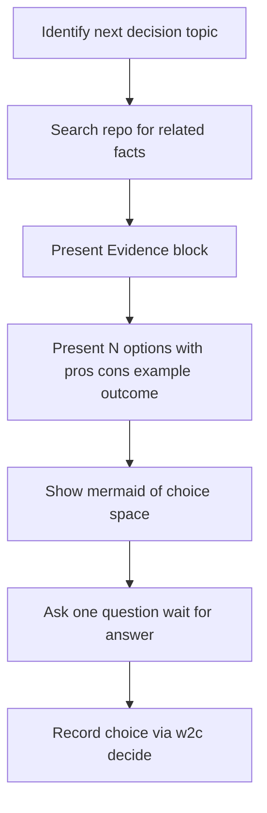

# Work to Chores

Requires: w2c >= 0.4.0

**Plan only.** Interview, review, plan, validate, write `.w2c/` artifacts. Never implement product code.

Read `USAGE.md` in this folder for the plain-English invocation.

## Prerequisites (hard stop)

Before Stage 1:

1. Confirm **grilling** and **brainstorming** are invocable in this environment.
2. Confirm `w2c` is on PATH (`command -v w2c`).

If grilling or brainstorming is missing: **STOP**. Log `--stage prereq --event stop --detail "missing grilling|brainstorming"`. Tell the user which skill is missing and ask them to add it. Do not invent a substitute interview.

If `w2c` is missing: **STOP**. Log `--stage prereq --event stop --detail "missing w2c CLI"`. Tell the user to run:

```bash
curl -fsSL https://raw.githubusercontent.com/OpenW2C/w2c/main/install.sh | bash
# or:
pipx install git+https://github.com/OpenW2C/w2c.git && w2c install-skills
```

Then they re-invoke this skill.

If `.w2c/` ledger files are missing, run `w2c init`.

Read `.w2c/config.toml`: `track = true` means plan artifacts are committed; default `track = false` keeps `.w2c/` gitignored.

**Worktree skill (mode-dependent):** as soon as Isolation mode is chosen as `worktree` (Stage 3), confirm **using-git-worktrees** is invocable the same way other skills are checked. If missing: **STOP**. Log `--stage prereq --event stop --detail "missing using-git-worktrees"`. Tell the user to add the Superpowers using-git-worktrees skill. Do not invent a substitute worktree procedure. Re-check before Stage 5 handoff if mode is still `worktree`.

## Status writes

Use the CLI only for STATE.md, QUEUE.md, ROADMAP emojis, task checkboxes, DECISIONS rows, and new CONTEXT versions:

```bash
w2c status
w2c decide --scope ... --decision ... --choice ... --rationale ...
w2c context-new --minor   # or --major
w2c next-milestone-id
w2c milestone-new --slug ...
w2c milestone-status M001 PLANNING
w2c milestone-order
w2c milestone-swap M011 M012
w2c milestone-move M012 --before M011
```

Never hand-edit those status bits, and never hand-edit roadmap milestone order. Authoring plan content (vision, tasks, verify commands, Git Operation Plan, Commit and PR conventions) is allowed after Stage 5 approval.

## Events (local only)

Append-only JSONL at `.w2c/runtime/events.jsonl`. Gitignored. Never commit it. Never hand-edit it. The CLI is the only writer.

```bash
w2c event --skill work-to-chores --stage STAGE --event EVENT [--milestone M###] [--slice S##] [--task T##] [--detail "..."]
w2c events --tail 20 [--skill work-to-chores]
```

`--event` is one of: `started`, `complete`, `pass`, `fail`, `stop`, `retry`.

Log at every stage enter/exit and every hard stop. `decide`, `milestone-new`, `context-new`, and `milestone-status` also append automatically.

## Interview question contract

Use this contract for **every** grilling and brainstorming question in Stages 1–3 (including Stage 2 gap resolution). One question at a time. Wait for an answer before the next.



### Evidence block (mandatory before the question)

Search the project for facts related to this decision. Present them **before** asking:

- What was searched (files, symbols, patterns)
- Facts found (tables OK): current implementation, call sites, related patterns, edge cases, absences
- How that evidence shapes the options

Do not ask the user for a fact you can look up in the repo.

### Options block (flexible count)

Always mark one option `[recommended]`.

- **Target ~4** meaningful options when the decision is open-ended
- **Fewer** when the decision is naturally narrow (e.g. yes/no, worktree vs branch)
- **More** when evidence shows additional real approaches worth choosing among
- Never invent filler or illegal options just to hit a count

For **each** option, in simple English (short sentences; gloss jargon in one line):

- What it means
- **Pros**
- **Cons**
- **Example**
- **Possible outcome**

Include **one mermaid diagram** that compares the options or shows the recommended flow vs alternatives. For a tiny choice set (yes/no), a small 2-node diagram is enough.

### After the answer

Save with `w2c decide` (short rationale is fine). Keep the rich write-up (why, pros/cons, outcome, diagram) for `M###-CONTEXT.md` **Decision Rationale** at plan-write time.

## Reorder pending milestones (no new plan)

If the user asks to reorder, swap, or change which pending milestone runs next, and they are not bringing a new ticket or spec, do **not** start Stage 1 and do **not** author a new milestone.

Log `--stage reorder --event started`.

1. Run `w2c milestone-order` and show that execution order (id, status, title). That is the Evidence block. `ROADMAP.md` line order is what `w2c next` walks. The numeric id is not the queue.
2. Grill one placement question with the interview contract. Options come from the real pending list. Recommended default when they did not name a target: leave the order unchanged. Other real choices: `w2c milestone-move M### --before OTHER` or `--after OTHER`, `w2c milestone-swap`, or `w2c milestone-order` with the relative ids.
3. Refuse a placement that swaps with an `INPROGRESS` milestone, moves ahead of it, or takes a `DONE` milestone's place. The way through is `w2c milestone-status M### PAUSED`, `STOP`, or `ERROR` (rejected), then reorder. Pending milestones that already sit after an in-progress milestone may be reordered among themselves.
4. Run the matching CLI command. Do not hand-edit `ROADMAP.md`, `QUEUE.md`, or `STATE.md`.
5. `w2c decide --scope <ids> --decision "execution order" --choice "<resulting order>" --rationale "<why>"`.
6. `w2c smoke`. Log `--stage reorder --event complete`.

Then stop. Do not write product code.

## Stage 1 - Gather context

Always run this stage, even when a ticket or spec is pasted. A reorder-only request is handled above and does not enter this stage.

Log `--stage gather --event started` before interviewing.

Need a hint of the work. If the prompt has no ticket, spec, or description: ask for one before interviewing.

Then, in order — each question follows the **Interview question contract**:

1. **Grilling** - one question at a time. Close when **scope, users, done criteria, risks, integrations, and out-of-scope** are clear. Log `--stage gather --event complete --detail grilling` when that pass closes (or `retry` if you must restart it).
2. **Brainstorming** - find structural gaps (edge cases, empty states, testing seams). When proposing approaches or gap solutions, use the same evidence-first options contract. Log `--stage gather --event complete --detail brainstorming` when it closes.
3. **Grilling again** - confirm each gap and pick a solution (same contract).

Log `--stage gather --event complete` when Stage 1 finishes.

Save knowledge with `w2c context-new` (first pass may use the `CONTEXTv1.0.md` from `init`; later loops always create a new file). Never overwrite an existing CONTEXT file.

Version bump: **major** if scope, users, or done-criteria change; **minor** for clarifications, risks, out-of-scope, wording.

Record major decisions with `w2c decide`.

## Stage 2 - Review context

Log `--stage review --event started`.

Review collected knowledge for architectural or design gaps that would break the original requirement.

If you find an issue, present in plain English:

- what is wrong
- impact
- then the **Interview question contract** (evidence, options with pros/cons/example/outcome, mermaid, recommended)

Wait for a choice. Save it with `w2c decide`. Then return to Stage 1 with a new CONTEXT version. Log `--stage review --event retry` before looping.

If no issue: log `--stage review --event complete`.

## Stage 3 - Plan

Log `--stage plan --event started`.

Break work into milestones `M###` (unique; `w2c next-milestone-id` / `w2c milestone-new --slug`). Each milestone has slices `S01`, `S02`, ... and tasks `T01`, `T02`, ... fully specified with a Verify line.

### Execution order of a new milestone

`w2c milestone-new` appends the new id at the end of `ROADMAP.md`. `w2c next` follows that line order, not the numeric id.

After `w2c milestone-new`, run `w2c milestone-order`. If another milestone that is not `INPROGRESS` or `DONE` can be reordered with this one without crossing an in-progress or done line, grill where the new milestone should run. Follow the interview contract. Recommended: leave it at the end. Other options are the real ones: `w2c milestone-move NEW --before OTHER`, `w2c milestone-swap`, or `w2c milestone-order` with the relative ids. Do not offer a move that takes an `INPROGRESS` or `DONE` place. If the user needs to jump an in-progress milestone, they must `w2c milestone-status` it to `PAUSED`, `STOP`, or `ERROR` first (`ERROR` means rejected).

Save with `w2c decide --scope M### --decision "execution order" --choice "..." --rationale "..."`.

When the chosen place is not the end, fill this milestone's Delivery & Guardrails **Execution sequence** cell with a plain sentence such as `before M011`. The cell is a note. Line order remains what `w2c next` uses.

Milestone states: PLANNING, TODO, PAUSED, INPROGRESS, DONE, ERROR, STOP.

Each task needs a testing or other verification plan. Embed this execution rule in every slice plan (do **not** execute it here):

- A task is not complete until Verify passes and **requesting-code-review** is clean. Loop fix, verify, review until both succeed. Write `S##-T##-SUMMARY.md`, then `w2c complete`.
- When every task in a slice is complete: re-run that slice’s Verify commands, write `S##-UAT.md` and `S##-SUMMARY.md`, then `w2c slice-complete`.
- When every slice in a milestone is complete: validate the whole milestone, write `M###-VALIDATION.md` and `M###-SUMMARY.md`, then `w2c milestone-complete`.

### Git isolation (required grilling — one question at a time)

During Stage 3, grill these decisions **before** the draft plan is marked ready. Follow the **Interview question contract**. Only two modes exist: `worktree` or `branch` (no in-place) — do not invent a third isolation mode.

1. **Isolation mode** — ask worktree vs branch. Plain English: worktree = separate directory via using-git-worktrees (recommended when that skill is available); branch = same checkout, switch/create the ticket branch. Save with `w2c decide`. If `worktree`, run the using-git-worktrees prereq check immediately.
2. **Branch name** — Local branch **must equal** Remote branch.
   - If an external ticket id exists (e.g. `MOR-252`): propose that exact id as the only remote/local branch name and confirm.
   - If no ticket: propose 2–3 slug options plus custom; confirm the exact string.
   - Save with `w2c decide`.

Isolation scope is always **ticket**: every milestone/slice for this ticket shares the same mode and branch. Setup happens on **first `do-chores`**, not during planning. Do **not** create a worktree in this skill.

After isolation grilling, read `.w2c/config.toml` `git_delivery`. If missing or invalid: **STOP**. Tell the user to run `w2c init --git-delivery slice-commit-milestone-push-pr|milestone-commit-milestone-push-pr` (or `w2c migrate … --git-delivery …`). Do not invent a cadence.

### DELIVERY-PROFILE (optional — no hard-stop)

After the `git_delivery` check, read `.w2c/DELIVERY-PROFILE.md` if present:

- Copy **Integration strategy** and **Integration branch (day-to-day)** (and Production branch when strategy is `gitflow`) into each milestone Delivery & Guardrails table.
- If the file is **missing**: leave Integration strategy as `(from .w2c/DELIVERY-PROFILE.md)` or blank and continue — do **not** STOP. Existing trunk-direct repos stay valid until they re-configure.

When creating the profile (configure-client or ad-hoc), interview **two independent** questions:

1. **Integration strategy:** `trunk-direct` | `feature-branch` | `gitflow` (prefer `gitflow` for mobile store apps).
2. **Use CI/CD pointers in DELIVERY-PROFILE?** `yes` | `no`. If yes, confirm path (default `ai-playbook/mobile/ci-cd/`).

Compose with `templates/DELIVERY-PROFILE.md` or `w2c.delivery_profile.compose_delivery_profile`. Never put `git_delivery` enum values or store secrets in the profile.

Default guardrails in each `M###-ROADMAP.md` Delivery and Guardrails table:

- Isolation mode + Branch name filled from the grilled decisions
- Integration strategy / branch from `.w2c/DELIVERY-PROFILE.md` when present
- Commit cadence / Push rule leave pointing at config (`git_delivery` is source of truth — do not bake a milestone or slice default into the plan)
- no commit / push / PR without explicit user approval for that action
- no per-run git handshake

Every `M###-ROADMAP.md` and every `M###-S##-PLAN.md` must include a filled **`## Git Operation Plan`** table (see templates). Slice plans must mirror the same Isolation mode, Local branch, and Remote branch as the milestone — do not invent a different branch.

Required Git Operation Plan fields (milestone is canonical):

| Field | Value |
| --- | --- |
| Isolation mode | `worktree` or `branch` |
| Local branch | ticket id or confirmed slug |
| Remote branch | **must equal** Local branch |
| Isolation scope | `ticket` |
| Setup when | `first-do-chores` |
| Plan commit | `required-before-isolation` |
| Reuse policy | `reuse-if-same-ticket-else-stop` |
| Worktree skill | `using-git-worktrees` if mode is `worktree`; `n/a` if `branch` |
| Push rule | from config + explicit approval; push ref must equal Remote branch |

Do not implement product code in this skill.

### Commit and PR conventions (required, per milestone)

After isolation grilling and before the draft is marked ready, **inspect the client repo** and fill `## Commit and PR conventions` on every `M###-ROADMAP.md` and every `M###-S##-PLAN.md`.

1. Read `CONTRIBUTING*`, `.github/*PULL_REQUEST_TEMPLATE*`, and recent `git log` title/body. Fill **Commit title**, **Commit body**, and **Pull request** from what this repo actually uses. If docs are missing, still fill from recent commit/PR history — do not leave TBD.
2. Fill **Do not stage / commit** with a deny-list: always `.w2c/runtime/`; when `.w2c/config.toml` has `track = false`, all of `.w2c/` and Copilot W2C instruction files; plus notable paths from client `.gitignore` (e.g. `.env*`, credentials, local IDE junk). State that product commits never stage these; plan-commit (only if `track = true`) may stage ledger/plan files under `.w2c/` except `runtime/`.
3. Fill **Do not mention:** never name any `.w2c/` path, ledger file, closeout report, or other W2C artifact in commit title/body or PR title/body/description (use “W2C ledger” / “planning artifacts” with no paths).
4. Slice plans must **copy the filled rules**, not “see parent”.
5. Every copy of the section must include **AI attribution — forbidden:** do not add `Co-authored-by:` trailers or similar Cursor / Copilot / Claude / Codex co-author lines.

`w2c smoke` **FAIL**s if the section is missing, empty, does not forbid `Co-authored-by`, omits `.w2c` path/artifact exclusion, or lacks do-not-stage / do-not-mention prohibitions.

### Milestone manual test guide (required grilling — one question at a time)

For **each milestone**, follow the **Interview question contract** (evidence may be short: user-visible vs docs/infra). Ask: “Do you want a step-by-step manual test file for this milestone’s scope, to run after the milestone is done?” Recommended: **yes** when the milestone changes user-visible behavior; **no** for docs/infra-only. Save with `w2c decide --scope M### --decision "milestone-scoped manual test guide" --choice yes|no`.

- If **yes:** set Delivery & Guardrails `Manual test guide` to `yes`. Write `.w2c/plans/M###-<slug>/M###-MANUAL-TEST.md` from `templates/M-MANUAL-TEST.md` — full, concise, numbered steps with expected results, scoped to this milestone. Banner must say it is **not** a completeness gate.
- If **no:** set `Manual test guide` to `no`. Do not write the file.

`w2c smoke` **FAIL**s if the field is missing, not `yes`/`no`, or is `yes` while `M###-MANUAL-TEST.md` is missing/empty. Milestone DONE still only requires `M###-VALIDATION.md` + `M###-SUMMARY.md` — never the manual-test file or that the human ran it.

Log `--stage plan --event complete` when the draft plan is ready for validation.

## Stage 4 - Validate the plan

Log `--stage validate --event started`. Until there are no pending issues or gaps, loop Stages 1-4. Never rewrite an existing CONTEXT; `w2c context-new --major` or `--minor`. Save decisions with `w2c decide`. Log `--stage validate --event retry` on each loop back, then `--stage validate --event complete` when clean.

Confirm Git Operation Plan is present and consistent across all milestones/slices for the ticket (same mode and branch). Confirm `.w2c/config.toml` has a valid `git_delivery`. Confirm every ROADMAP and slice PLAN has a filled `## Commit and PR conventions` section (repo-detected title/body/PR rules, deny-list + do-not-mention `.w2c/` artifacts, plus the Co-authored-by ban). Confirm each milestone Delivery & Guardrails `Manual test guide` is `yes` or `no`, and if `yes` that `M###-MANUAL-TEST.md` exists and is non-empty. When grilled decisions exist, confirm each milestone `M###-CONTEXT.md` has a filled **Decision Rationale** (choice, why, pros, cons, expected outcome, diagram) — not only Key Decisions bullets. Do not require plan cells to duplicate the chosen cadence — config is source of truth.

## Stage 5 - User review

Log `--stage user-review --event started`. Ask the user to review the plan (including isolation mode and branch name, and Decision Rationale in each `M###-CONTEXT.md`). If they request a change:

1. Do not trust it until checked against the original requirement.
2. If it fits: restate what you understood and your suggested adjustment; wait for confirmation; then Stage 1 with a new CONTEXT version. Log `--stage user-review --event retry`.
3. If it does not fit: explain the mismatch; do not change the plan. Log `--stage user-review --event fail --detail mismatch`.

When they approve: log `--stage user-review --event complete`.

## Write the plan (after approval only)

Log `--stage write --event started` before creating or filling milestone files.

Canonical tree:

```text
.w2c/
  plans/M###-<slug>/
    M###-ROADMAP.md
    M###-CONTEXT.md
    M###-S##-PLAN.md
    S##-T##-SUMMARY.md
    S##-UAT.md
    S##-SUMMARY.md
    M###-VALIDATION.md
    M###-SUMMARY.md
    M###-MANUAL-TEST.md   # optional; only if Manual test guide is yes
  contexts/CONTEXTvX.Y.md
  DECISIONS.md
  ROADMAP.md
  STATE.md
  QUEUE.md
```

Use `w2c milestone-new` then fill ROADMAP/CONTEXT/slice plan content (including Git Operation Plan and Commit and PR conventions). Formats: follow the templates in this repo (`templates/`) and README.md. Milestone files are `M###-ROADMAP.md` + `M###-CONTEXT.md` + slice plans - never a second `M###-PLAN.md`.

**`## Slices` format is a hard requirement, not a style choice.** The CLI's `parse_slices()` only recognizes literal `- [ ] **S01: <title>**` checkbox lines (see `templates/M-ROADMAP.md`) — a markdown table, bullet list, or any other shape parses as zero slices, and `slice-complete` / `milestone-complete` will fail with a confusing "slices still open" error later, even after every task is done. Write one `- [ ] **S##: <title>**` line per slice, nothing else, and run `w2c smoke` before handoff — it checks `roadmap-slices-match-plans` and will FAIL if any on-disk `M###-S##-PLAN.md` is not represented as a checkbox line.

When filling each `M###-CONTEXT.md`, copy every Stage 1–3 grilled decision into **Decision Rationale** (not only a one-line Key Decisions bullet): choice, why we chose it, pros, cons, expected outcome, and the mermaid diagram. `w2c decide` rationale may stay short; the rich write-up lives here.

`w2c milestone-status` / `w2c set` for pointers. `w2c smoke` before handing off to do-chores — smoke **fails** if `git_delivery` is missing/invalid in `.w2c/config.toml`, Git Operation Plan is missing, Isolation mode is not `worktree`/`branch`, Local≠Remote, branch is empty/`N/A`, worktree mode lacks `using-git-worktrees` in Worktree skill, `## Commit and PR conventions` is missing/empty, does not forbid `Co-authored-by`, or lacks deny-list / do-not-mention `.w2c` rules, `Manual test guide` is missing or not `yes`/`no`, or that field is `yes` without a non-empty `M###-MANUAL-TEST.md`. Log `--stage write --event complete` when smoke is clean.

### Plan-commit gate (only when `track = true`)

If `.w2c/config.toml` has `track = false` (default): **skip this gate**. Do not commit `.w2c/` or Copilot W2C instruction files. Log `--stage plan-commit --event complete --detail skipped-untracked`. Then tell the user: run `do-chores` next; isolation setup happens on the first execution unit. If a worktree is used, do-chores will symlink or copy `.w2c/` into it.

If `track = true`: after smoke PASS, ask for explicit approval to put plan artifacts on the ticket branch so first `do-chores` isolation can see `.w2c/`:

1. If the local branch named Remote branch does not exist: create it from current HEAD only when the working tree is clean **or** dirty only with the new `.w2c/` plan/ledger files. Otherwise **STOP** and ask.
2. Check out that branch under the same clean/dirty rules. Never force-checkout, force-reset, or delete branches/worktrees.
3. Commit **only** `.w2c/` plan and ledger files (plans, STATE/QUEUE/ROADMAP/DECISIONS/contexts as needed). Never product code. Never `.w2c/runtime/`.
4. **Do not push.**

Log `--stage plan-commit --event complete` (or `stop` / `fail`) with the branch name in `--detail`.

Then tell the user: run `do-chores` next; isolation setup (worktree create or branch ensure) happens on the first execution unit.

## Red flags - STOP

- Implementing product code
- Skipping grilling or brainstorming
- Asking a grill/brainstorm question without an Evidence block first
- Padding options with fake or illegal choices just to hit a count
- Presenting options without pros, cons, example, possible outcome, and a mermaid diagram
- Writing plans without Decision Rationale for grilled choices in `M###-CONTEXT.md`
- Overwriting CONTEXTvX.Y.md
- Hand-editing STATE/QUEUE/checkboxes/ROADMAP emojis
- Writing milestone files before Stage 5 approval
- Reusing a milestone id
- Committing `.w2c/runtime/` or hand-editing `events.jsonl`
- Skipping branch confirmation or writing `N/A` / unequal Local vs Remote branch
- Creating a worktree during planning (setup is first `do-chores` only)
- Pushing or opening a PR from this skill
- Inventing commit cadence when `git_delivery` is missing from `.w2c/config.toml`
- Committing product code without explicit user approval
- Inventing a worktree procedure when using-git-worktrees is missing
- Writing empty or “see parent” Commit and PR conventions, or omitting the Co-authored-by ban, deny-list, or do-not-mention `.w2c/` rules
- Adding `Co-authored-by:` or similar AI co-author trailers
- Skipping the milestone manual-test-guide question
- Treating unread `M###-MANUAL-TEST.md` steps as a milestone completeness failure
- Renumbering milestone ids to change execution order
- Hand-editing roadmap milestone order, queue order, or the state registry order
- Swapping with or moving ahead of an `INPROGRESS` milestone. The way through is `w2c milestone-status` to `PAUSED`, `STOP`, or `ERROR`, then reorder
