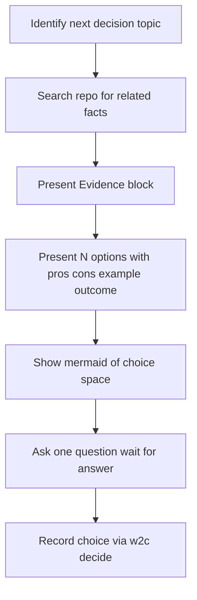

# Work to Chores

Requires: w2c >= 3.5.0

**Plan only.** Interview, review, plan, validate, write `.w2c/` artifacts. Never implement product code.

Read `USAGE.md` in this folder for the plain-English invocation.

## Prerequisites (hard stop)

Before Stage 1:

1. Confirm **grilling** and **brainstorming** are invocable in this environment.
2. Confirm `w2c` is on PATH (`command -v w2c`).

If grilling or brainstorming is missing: **STOP**. Log `--stage prereq --event stop --detail "missing grilling|brainstorming"`. Tell the user which skill is missing and ask them to add it. Do not invent a substitute interview.

If `w2c` is missing: **STOP**. Log `--stage prereq --event stop --detail "missing w2c CLI"`. Tell the user to run:

```bash
curl -fsSL https://raw.githubusercontent.com/OpenW2C/w2c/main/install.sh | bash
# or:
pipx install git+https://github.com/OpenW2C/w2c.git && w2c install-skills
```

Then they re-invoke this skill.

If `.w2c/` ledger files are missing, run `w2c init`.

Read `.w2c/config.toml`: `track = true` means plan artifacts are committed; default `track = false` keeps `.w2c/` gitignored.

**Worktrees:** W2C creates the directory with `w2c worktree-add`. Do not call the editor's worktree tool and do not stop when using-git-worktrees is missing. Still write `using-git-worktrees` in the Worktree skill field so older plans keep passing smoke. Read `w2c help worktrees` when you need the layout or the ledger rules. Read `w2c help bare-container` only when the user asks how to build a bare container. Do not paste those steps, and do not offer to convert the repository.

## Planning mode

Default is OpenSpec. Record the choice before Stage 1:

```bash
w2c decide --scope planning --decision "planning mode" --choice openspec --rationale "org standard"
```

Use `classic` when the user said `classic` or `legacy` (`legacy` is an alias of `classic`).

- **OpenSpec** (default): one milestone is one OpenSpec change. Behavior specs stay in `openspec/changes/<slug>/`. W2C delivery rules stay in `.w2c/plans/M###-<slug>/`. Do not fork the spec-driven schema.
- **Classic**: follow the stages below exactly as they stand. Do not run `openspec`. Do not create `openspec/`.

### OpenSpec install (ask first)

Skip this when the mode is classic.

Run `w2c openspec-check`. Read the JSON. If `needs` contains `NEED_OPENSPEC_INSTALL` or `NEED_OPENSPEC_INIT`, stop and ask the user before changing the machine or the project. On no: stop, or offer classic. On yes, follow this prompt and stop where it tells you to stop:

```text
Fetch https://raw.githubusercontent.com/Fission-AI/OpenSpec/main/install.md and follow it.
```

That prompt's own stops still apply: confirm before installing, no sudo, never edit shell startup files, and list what `openspec init` will delete before it runs. Adding the W2C rules snippet to `openspec/config.yaml` (`rules.tasks` containing `W2C-OPENSPEC-RULES`, from `w2c.openspec.CONFIG_RULES_SNIPPET`) needs its own yes. Re-run `w2c openspec-check` after install or init.

### OpenSpec additions to Stages 1–3

Keep the interview contract. Also:

- Evidence includes `openspec list --specs` and `openspec show <id> --type spec` before you name a capability. Reuse an existing capability path when the behavior already exists.
- Stage 3 grills one capabilities question: which capabilities are new, which existing ones change, or `skip_specs` when behavior does not change. Save it with `w2c decide`.
- A slice is one `## N.` group in `tasks.md`. A task is `- [ ] N.M` plus an indented `- Verify:` line. Slice plan files stay delivery envelopes and contain no task checkboxes. Copy `templates/openspec/M-S-PLAN.md`. When filling that envelope, keep `## Verification` scoped (see **Verification scope**).
- Isolation, base dirt, manual test, and commit conventions grilling are unchanged. Conventions must also say `openspec/` is product content and is never deny-listed.

### OpenSpec write (only after Stage 5 approval)

1. `w2c milestone-new --slug <change> --planning openspec`. That runs `openspec new change` and writes `x-w2c-milestone`.
2. For each artifact, run `openspec instructions <artifact> --change <change> --json` and write the file it names. Order is proposal, then specs, then design, then tasks.
3. Fill the sidecar: slices as `- [ ] **S0N: title**` matching `## N.` groups, Git Operation Plan, conventions, and Decision Rationale in `M###-CONTEXT.md`.
4. `openspec validate <change> --strict` and `w2c smoke --milestone M###` for the milestone being written. A format-only failure can be fixed in place. A content change goes back to Stage 1 with a new CONTEXT version.

### Spec-commit gate (OpenSpec mode, always)

After content smoke passes, **before** asking to commit the change folder:

1. Run `w2c openspec-check` (or milestone smoke) and inspect `NEED_OPENSPEC_UNIGNORE` / `openspec-not-ignored`.
2. If the change path is gitignored (often a whole-tree `openspec/` rule): **STOP**. Grill approval to remove or negate that rule for the **entire** `openspec/` tree so it is normal product content. Apply the `.gitignore` edit only after yes. Ask a **separate** yes before committing the `.gitignore` change. **Never** use `git add -f` / force-add.
3. Re-run the ignore probe. Do not continue while the change is still ignored.

Then ask for approval to commit the change folder. This is not a push.

When Isolation mode is `branch`:

1. Follow **Applying Base dirt policy**. `w2c base-dirt` ignores this milestone's `openspec/changes/<change>/`.
2. Create or check out the ticket branch under those rules. Never force.
3. Commit only `openspec/changes/<change>/`. When `track = true`, a separate plan commit may also include `.w2c/` plan files except `runtime/`. Files from `openspec init` need their own yes. Never stage deny-listed paths. Never mention any `.w2c/` path in the message. Never add a `Co-authored-by` trailer.
4. Do not push.

When Isolation mode is `worktree`:

1. Do not check the ticket branch out in the current checkout. That would lock the branch, and the worktree could not be added.
2. Run `w2c worktree-add --branch <name> --create-from HEAD`. Pass `--exclude no` only when the plan's Exclude line is `exclude-no`. Otherwise the default `--exclude yes` is correct.
3. `git worktree add` does not bring untracked files. Move `openspec/changes/<change>/` into that worktree. Enforce seed policy before committing: if `worktree_seed_policy` is `unset` (or `--check` prints `seed-policy-unset`), **STOP** (planning incomplete). If `none`, `--check` passes. If `paths`, run `w2c worktree-seed --check` in the worktree; repair once with `w2c worktree-seed`; **STOP** if still failing. Name the paths. Do not rely on ad-hoc `cp` of secrets. Never put `openspec/` on `worktree_seed`.
4. In the worktree, commit only `openspec/changes/<change>/`. Do not stage `.w2c/`. Never mention any `.w2c/` path. Never add a `Co-authored-by` trailer.
5. Do not push. The checkout you started in stays on its current branch.

After the change commit (or after declining it):

1. Re-run `w2c smoke --milestone M###` (or `w2c openspec-check`).
2. If `openspec-not-ignored` or `openspec-change-tracked` fails: **STOP**. Do not hand off. Fix ignore / finish a normal (non-force) spec commit first.
3. Set OpenSpec Git Operation Plan `Setup when` to `spec-commit`. Do **not** use `first-do-chores` for OpenSpec isolation of the change folder.

Log `--stage plan-commit --event complete` with the branch name only when smoke is clean for this milestone. Then tell the user to run `do-chores`. `do-chores` reuses this worktree. Classic mode still uses the plan-commit gate below, and only when `track = true`.

## Status writes

Use the CLI only for STATE.md, QUEUE.md, ROADMAP emojis, task checkboxes, DECISIONS rows, and new CONTEXT versions:

```bash
w2c status
w2c decide --scope ... --decision ... --choice ... --rationale ...
w2c context-new --minor   # or --major
w2c next-milestone-id
w2c milestone-new --slug ...
w2c milestone-status M001 PLANNING
w2c milestone-order
w2c milestone-swap M011 M012
w2c milestone-move M012 --before M011
```

Never hand-edit those status bits, and never hand-edit roadmap milestone order. Authoring plan content (vision, tasks, verify commands, Git Operation Plan, Commit and PR conventions) is allowed after Stage 5 approval.

## Events (local only)

Append-only JSONL at `.w2c/runtime/events.jsonl`. Gitignored. Never commit it. Never hand-edit it. The CLI is the only writer.

```bash
w2c event --skill work-to-chores --stage STAGE --event EVENT [--milestone M###] [--slice S##] [--task T##] [--detail "..."]
w2c events --tail 20 [--skill work-to-chores]
```

`--event` is one of: `started`, `complete`, `pass`, `fail`, `stop`, `retry`.

Log at every stage enter/exit and every hard stop. `decide`, `milestone-new`, `context-new`, and `milestone-status` also append automatically.

## Interview question contract

Use this contract for **every** grilling and brainstorming question in Stages 1–3 (including Stage 2 gap resolution). One question at a time. Wait for an answer before the next.



### Evidence block (mandatory before the question)

Search the project for facts related to this decision. Present them **before** asking:

- What was searched (files, symbols, patterns)
- Facts found (tables OK): current implementation, call sites, related patterns, edge cases, absences
- How that evidence shapes the options

Do not ask the user for a fact you can look up in the repo.

### Options block (flexible count)

Always mark one option `[recommended]`.

- **Target ~4** meaningful options when the decision is open-ended
- **Fewer** when the decision is naturally narrow (e.g. yes/no, worktree vs branch)
- **More** when evidence shows additional real approaches worth choosing among
- Never invent filler or illegal options just to hit a count

For **each** option, in simple English (short sentences; gloss jargon in one line):

- What it means
- **Pros**
- **Cons**
- **Example**
- **Possible outcome**

Include **one mermaid diagram** that compares the options or shows the recommended flow vs alternatives. For a tiny choice set (yes/no), a small 2-node diagram is enough.

### After the answer

Save with `w2c decide` (short rationale is fine). Keep the rich write-up (why, pros/cons, outcome, diagram) for `M###-CONTEXT.md` **Decision Rationale** at plan-write time.

## Reorder pending milestones (no new plan)

If the user asks to reorder, swap, or change which pending milestone runs next, and they are not bringing a new ticket or spec, do **not** start Stage 1 and do **not** author a new milestone.

Log `--stage reorder --event started`.

1. Run `w2c milestone-order` and show that execution order (id, status, title). That is the Evidence block. `w2c next` with no milestone prefers an in-progress milestone, then planning and to-do milestones, in `ROADMAP.md` line order. It skips paused, stopped, and rejected milestones. The numeric id is not the queue.
2. Grill one placement question with the interview contract. Options come from the real pending list. Recommended default when they did not name a target: leave the order unchanged. Other real choices: `w2c milestone-move M### --before OTHER` or `--after OTHER`, `w2c milestone-swap`, or `w2c milestone-order` with the relative ids.
3. Refuse a placement that swaps with an `INPROGRESS` milestone, moves ahead of it, or takes a `DONE` milestone's place. The way through is `w2c milestone-status M### PAUSED`, `STOP`, or `ERROR` (rejected), then reorder. Pending milestones that already sit after an in-progress milestone may be reordered among themselves.
4. Run the matching CLI command. Do not hand-edit `ROADMAP.md`, `QUEUE.md`, or `STATE.md`.
5. `w2c decide --scope <ids> --decision "execution order" --choice "<resulting order>" --rationale "<why>"`.
6. `w2c smoke --milestone` for each milestone whose position changed. Log `--stage reorder --event complete`.

Then stop. Do not write product code.

## Amend an unfinished milestone (no new plan)

If the user wants to drop, change, or add open work in a milestone that already exists, do not start Stage 1 and do not author a new milestone. This is not a reorder.

Allowed statuses are `PLANNING`, `TODO`, `PAUSED`, and `INPROGRESS`. Refused statuses are `DONE`, `STOP`, and `ERROR`.

Log `--stage amend --event started`.

1. Show which tasks are finished. Those stay as written. Do not drop a finished task. Do not drop a slice that has a finished task. Do not change behavior a finished task already implemented.
2. Propose one batch: each drop, edit, or add, with the reason. For a drop, ask whether anything must be picked up later. If no, the record stores only the reason. If yes, show a short context: what was dropped, why, and what is left. Then ask the user either to allow ticket creation or to create the ticket themselves. `w2c` does not call a tracker. If the user says yes, they name the tracker in that moment and you may create the ticket with tools already available, then store the link. If the user will create it, the link may be empty.
3. Wait for one approval of the whole batch. If the user says no, revise the batch and ask again. Do not run `w2c amend-begin` before that yes.
4. After the yes, record one `w2c decide` row and one `w2c context-new`. Use `--major` when a drop or a change to the conditions that mark the work done alters scope. Use `--minor` when the wording changes and the scope stays the same.
5. Run `w2c amend-begin M### --decision D###`. If the status is `INPROGRESS`, this pauses the milestone and sets the amendment lock so `w2c next` will not execute it. `PLANNING` and `TODO` stay as they are, and the lock is still set.
6. Apply only the approved commands, each citing that same decision: `w2c drop-task`, `w2c drop-slice`, `w2c task-add`, `w2c slice-add`, and `w2c task-edit`. Append ids. Do not renumber. If `drop-task` prints `NEED_DROP_SLICE`, run `drop-slice` only when that slice drop was in the approved batch; otherwise stop and ask. If it prints `NEED_SLICE_REPORTS` or `NEED_SLICE_COMPLETE`, leave the slice in place. Its closeout still needs `S##-UAT.md` and `S##-SUMMARY.md`, and the summary must name the dropped task ids.
7. After that same approval, you may edit spec prose: the Open Specification (OpenSpec) proposal, behavior specs, and design, or the classic success criteria. Do not change behavior a finished task already implemented. In OpenSpec mode, run `openspec validate --strict`.
8. Run `w2c smoke --milestone M###`. On failure the amendment lock stays. On success run `w2c amend-end M###`. If the saved status was `INPROGRESS` and the batch changed the milestone, it stays `PAUSED` until the user sets the status. If there were no mutations, `amend-end` restores the saved status.
9. `w2c follow-up` can set or replace only the ticket link later. The reason text stays fixed.

Log `--stage amend --event complete` after `amend-end`. Then stop. Do not write product code.

## Classic planning stages

OpenSpec mode follows these stages and the OpenSpec additions above. Classic mode (`work-to-chores classic` or `legacy`) follows only these stages.

## Stage 1 - Gather context

Always run this stage, even when a ticket or spec is pasted. A reorder-only request and an amend-only request are handled above and do not enter this stage.

Log `--stage gather --event started` before interviewing.

Need a hint of the work. If the prompt has no ticket, spec, or description: ask for one before interviewing.

Then, in order — each question follows the **Interview question contract**:

1. **Grilling** - one question at a time. Close when **scope, users, done criteria, risks, integrations, and out-of-scope** are clear. Log `--stage gather --event complete --detail grilling` when that pass closes (or `retry` if you must restart it).
2. **Brainstorming** - find structural gaps (edge cases, empty states, testing seams). When proposing approaches or gap solutions, use the same evidence-first options contract. Log `--stage gather --event complete --detail brainstorming` when it closes.
3. **Grilling again** - confirm each gap and pick a solution (same contract).

Log `--stage gather --event complete` when Stage 1 finishes.

Save knowledge with `w2c context-new` (first pass may use the `CONTEXTv1.0.md` from `init`; later loops always create a new file). Never overwrite an existing CONTEXT file.

Version bump: **major** if scope, users, or done-criteria change; **minor** for clarifications, risks, out-of-scope, wording.

Record major decisions with `w2c decide`.

## Stage 2 - Review context

Log `--stage review --event started`.

Review collected knowledge for architectural or design gaps that would break the original requirement.

If you find an issue, present in plain English:

- what is wrong
- impact
- then the **Interview question contract** (evidence, options with pros/cons/example/outcome, mermaid, recommended)

Wait for a choice. Save it with `w2c decide`. Then return to Stage 1 with a new CONTEXT version. Log `--stage review --event retry` before looping.

If no issue: log `--stage review --event complete`.

## Stage 3 - Plan

Log `--stage plan --event started`.

Break work into milestones `M###` (unique; `w2c next-milestone-id` / `w2c milestone-new --slug`). Each milestone has slices `S01`, `S02`, ... and tasks `T01`, `T02`, ... fully specified with a Verify line.

### Execution order of a new milestone

`w2c milestone-new` appends the new id at the end of `ROADMAP.md`. `w2c next` prefers an in-progress milestone, then uses that line order for planning and to-do milestones. The numeric id is not the queue.

After `w2c milestone-new`, run `w2c milestone-order`. If another milestone that is not `INPROGRESS` or `DONE` can be reordered with this one without crossing an in-progress or done line, grill where the new milestone should run. Follow the interview contract. Recommended: leave it at the end. Other options are the real ones: `w2c milestone-move NEW --before OTHER`, `w2c milestone-swap`, or `w2c milestone-order` with the relative ids. Do not offer a move that takes an `INPROGRESS` or `DONE` place. If the user needs to jump an in-progress milestone, they must `w2c milestone-status` it to `PAUSED`, `STOP`, or `ERROR` first (`ERROR` means rejected).

Save with `w2c decide --scope M### --decision "execution order" --choice "..." --rationale "..."`.

When the chosen place is not the end, fill this milestone's Delivery & Guardrails **Execution sequence** cell with a plain sentence such as `before M011`. The cell is a note. Line order remains what `w2c next` uses inside a status.

Milestone states: PLANNING, TODO, PAUSED, INPROGRESS, DONE, ERROR, STOP.

Each task needs a testing or other verification plan. Embed this execution rule in every slice plan (do **not** execute it here):

- A task is not complete until Verify passes and **requesting-code-review** is clean. Loop fix, verify, review until both succeed. Write `S##-T##-SUMMARY.md`, then `w2c complete`.
- When every task in a slice is complete: re-run that slice’s Verify commands, write `S##-UAT.md` and `S##-SUMMARY.md`, then `w2c slice-complete`.
- When every slice in a milestone is complete: validate the whole milestone, write `M###-VALIDATION.md` and `M###-SUMMARY.md`, then `w2c milestone-complete`.

### Git isolation (required grilling — one question at a time)

During Stage 3, grill these decisions **before** the draft plan is marked ready. Follow the **Interview question contract**. Only two modes exist: `worktree` or `branch` (no in-place) — do not invent a third isolation mode.

1. **Isolation mode** — ask worktree vs branch. Plain English: worktree = a separate directory created later by `w2c worktree-add`; branch = same checkout, switch/create the ticket branch. Save with `w2c decide`. If `worktree`, run `w2c repo-layout` and record the printed layout. Do not ask the user to accept that layout. Do not offer to convert the repository.

   **Worktree seed policy** — only when Isolation mode is `worktree`. Read `worktree_seed_policy` from `.w2c/config.toml`.
   - `paths` or `none`: reuse. Do **not** re-grill unless the user asks to amend seed policy.
   - `unset` (or missing key): Evidence — run `w2c worktree-seed --suggest` and note whether those sources exist on the main checkout. Grill: **`paths`** (edit the relative path list; never put `openspec/` on it) or **`none`** (no seeding; new env files later must not auto-flip this). Write `worktree_seed_policy` and `worktree_seed` **after yes**. Record `w2c decide` for the choice. Do not hand off worktree isolation while still `unset`.
   - Branch mode: skip this grill; leave policy as-is.

2. **Branch name** — Local branch **must equal** Remote branch.
   - If an external ticket id exists (e.g. `MOR-252`): propose that exact id as the only remote/local branch name and confirm.
   - If no ticket: propose 2–3 slug options plus custom; confirm the exact string.
   - Save with `w2c decide`.

3. **Base dirt policy** — only after Isolation mode is saved.
   - If mode is `worktree`: do not ask. Save with `w2c decide --scope M### --decision "base branch dirt" --choice "n/a-worktree" --rationale "worktree leaves untracked files in the original checkout"`. Set `Base dirt policy` to `n/a-worktree`. Do not write `### Base dirt paths`.
   - If mode is `branch`: run `w2c base-dirt`. If it exits non-zero, **STOP** and show the error. Do not invent a classification.
     - `status` `clean`: do not ask. Save choice `clean-at-plan`. Set `Base dirt policy` to `clean-at-plan`. Do not write `### Base dirt paths`.
     - `status` `noncritical`: ask the option question in this turn. Mark **Leave untouched** `[recommended]`.
     - `status` `critical`: this turn is a warning only. List every `critical` path. Say these files will ride into the milestone checkout as uncommitted changes and can be committed by mistake. If `note` is non-empty, include it. Do **not** show the four options. If the user answers with an option on this turn, reject it and repeat the warning. Only after they explicitly confirm they want to see the choices, ask the option question. On that question, mark **Pause and clean** `[recommended]`.

   The option question follows the Interview question contract. Evidence is the `w2c base-dirt` JSON, including `note` when it is non-empty. Options, in this order:

   1. **Leave untouched** — “Unrelated untracked files are intentional; leave them untouched.” Choice `leave-untouched`. The branch may be created later. Do not add, commit, stash, delete, or gitignore those paths. Later product commits must not stage them.
   2. **Pause and clean** — choice `pause-and-clean`. Do not create the branch. The user removes or moves the files, then says to continue. Re-run `w2c base-dirt`. A clean re-scan becomes `clean-at-plan`. If still dirty, run this step again, including the critical warning when `status` is `critical`.
   3. **Pause for the base branch** — choice `pause-for-base`. Do not create the ticket branch. Those files stay on the base branch. Any commit there is a separate explicit approval. This step does not commit. Resume the same way as pause and clean.
   4. **Abort branch setup** — choice `abort-branch-setup`. Stop. Do not create the branch and do not continue isolation for this milestone until the user starts planning again.

   Pause and abort are not `Base dirt policy` values. Record them with `w2c decide` only. Do not write them into the Git Operation Plan.

   When the choice is `leave-untouched`, set `Base dirt policy` to `leave-untouched` and write this subsection under `## Git Operation Plan`, before the next `##`:

   ```markdown
   ### Base dirt paths

   Critical:
   (none)

   Other (do not stage):
   - NOTES.md
   ```

   Copy `critical` and `other` from that scan. Use `(none)` when a list is empty. The critical list may be empty. The subsection body must not be empty. Slice plans copy the same field and the same subsection.

   ```mermaid
   flowchart TD
     scan[w2c base-dirt]
     scan -->|clean| clean[clean-at-plan]
     scan -->|noncritical| menu[Four options]
     scan -->|critical| warn[Warning only]
     warn -->|confirmed| menu
     menu -->|leave untouched| saved[leave-untouched plus paths]
     menu -->|pause or abort| stopNode[Do not create the branch]
   ```

   Show that diagram with the option question.

When Isolation mode is `worktree`, after `w2c repo-layout`:

- Write `Worktree layout` and `Worktree dir` from that output. There is no yes/no question for the layout.
- If `exclude` is `missing`, ask once whether to add the worktree directory to Git's local exclude file (`info/exclude`). Default is yes. Record `exclude-yes`, `exclude-no`, or `already-set` with `w2c decide` and in the Exclude line. A bare container prints `exclude: n/a`; do not ask.
- Do not create the worktree in this step. The OpenSpec spec-commit gate creates it. Classic mode leaves creation to the first `do-chores`.

Isolation scope is always **ticket**: every milestone/slice for this ticket shares the same mode and branch. Setup for classic mode happens on **first `do-chores`**, not during planning.

After isolation grilling, read `.w2c/config.toml` `git_delivery`. If missing or invalid: **STOP**. Tell the user to run `w2c init --git-delivery slice-commit-milestone-push-pr|milestone-commit-milestone-push-pr` (or `w2c migrate … --git-delivery …`). Do not invent a cadence.

### Verification scope (slice pass)

When filling task `- Verify:` lines and each slice `## Verification`:

- Prefer **scoped** commands that cover only the files or paths this slice owns (example: a package test runner pointed at those paths).
- Optional: lint or format checks on **touched files only**.
- **Do not** put full-repo test, full lint, full format, or full type-check suites in those slice-pass fields.
- **Do not** invent type-check diagnostic comparisons, pinned baseline SHAs, error-count allowances, or “existing failures are OK” waivers.
- Roadmap / Delivery Plan **Validation commands** may list full-repo suites — that row is for milestone closeout, commit, and push gates, not slice pass. Do not empty it to satisfy scoped-only.
- Read `.w2c/DELIVERY-PROFILE.md` **Validation** when present: use its slice-pass rules for Verify / Verification; use its milestone / PR gates for **Validation commands**. Profile must not reintroduce full-repo suites into slice-pass fields unless grilled.

### DELIVERY-PROFILE (optional — no hard-stop)

After the `git_delivery` check, read `.w2c/DELIVERY-PROFILE.md` if present:

- Copy **Integration strategy** and **Integration branch (day-to-day)** (and Production branch when strategy is `gitflow`) into each milestone Delivery & Guardrails table.
- If the file is **missing**: leave Integration strategy as `(from .w2c/DELIVERY-PROFILE.md)` or blank and continue — do **not** STOP. Existing trunk-direct repos stay valid until they re-configure.

When creating the profile (configure-client or ad-hoc), interview **two independent** questions:

1. **Integration strategy:** `trunk-direct` | `feature-branch` | `gitflow` (prefer `gitflow` for mobile store apps).
2. **Use CI/CD pointers in DELIVERY-PROFILE?** `yes` | `no`. If yes, confirm path (default `ai-playbook/mobile/ci-cd/`).

Compose with `templates/DELIVERY-PROFILE.md` or `w2c.delivery_profile.compose_delivery_profile`. Never put `git_delivery` enum values or store secrets in the profile.

Default guardrails in each `M###-ROADMAP.md` Delivery and Guardrails table:

- Isolation mode + Branch name filled from the grilled decisions
- Integration strategy / branch from `.w2c/DELIVERY-PROFILE.md` when present
- Commit cadence / Push rule leave pointing at config (`git_delivery` is source of truth — do not bake a milestone or slice default into the plan)
- no commit / push / PR without explicit user approval for that action
- no per-run git handshake

Every `M###-ROADMAP.md` and every `M###-S##-PLAN.md` must include a filled **`## Git Operation Plan`** table (see templates). Slice plans must mirror the same Isolation mode, Local branch, Remote branch, and Base dirt policy as the milestone — do not invent a different branch.

Required Git Operation Plan fields (milestone is canonical):

| Field | Value |
| --- | --- |
| Isolation mode | `worktree` or `branch` |
| Local branch | ticket id or confirmed slug |
| Remote branch | **must equal** Local branch |
| Isolation scope | `ticket` |
| Setup when | `spec-commit` (OpenSpec) or `first-do-chores` (classic) |
| Plan commit | `ledger-bind` when `track` is false; `required-before-isolation` when `track` is true |
| Reuse policy | `reuse-if-same-ticket-else-stop` |
| Worktree skill | `using-git-worktrees` if mode is `worktree`; `n/a` if `branch` |
| Worktree layout | `main-checkout` or `bare-container` when mode is `worktree` |
| Worktree dir | directory from `w2c repo-layout` when mode is `worktree` |
| Exclude line | `exclude-yes`, `exclude-no`, `already-set`, or `n/a` |
| Push rule | from config + explicit approval; push ref must equal Remote branch |
| Base dirt policy | `n/a-worktree`, `clean-at-plan`, or `leave-untouched` |

Do not implement product code in this skill.

### Commit and PR conventions (required, per milestone)

After isolation grilling and before the draft is marked ready, **inspect the client repo** and fill `## Commit and PR conventions` on every `M###-ROADMAP.md` and every `M###-S##-PLAN.md`.

1. Read `CONTRIBUTING*`, `.github/*PULL_REQUEST_TEMPLATE*`, and recent `git log` title/body. Fill **Commit title**, **Commit body**, and **Pull request** from what this repo actually uses. If docs are missing, still fill from recent commit/PR history — do not leave TBD.
2. Fill **Do not stage / commit** with a deny-list: always `.w2c/runtime/`; when `.w2c/config.toml` has `track = false`, all of `.w2c/` and Copilot W2C instruction files; plus notable paths from client `.gitignore` (e.g. `.env*`, credentials, local IDE junk). State that product commits never stage these; plan-commit (only if `track = true`) may stage ledger/plan files under `.w2c/` except `runtime/`.
3. Fill **Do not mention:** never name any `.w2c/` path, ledger file, closeout report, or other W2C artifact in commit title/body or PR title/body/description (use “W2C ledger” / “planning artifacts” with no paths).
4. Slice plans must **copy the filled rules**, not “see parent”.
5. Every copy of the section must include **AI attribution — forbidden:** do not add `Co-authored-by:` trailers or similar Cursor / Copilot / Claude / Codex co-author lines.

`w2c smoke` **FAIL**s if the section is missing, empty, does not forbid `Co-authored-by`, omits `.w2c` path/artifact exclusion, or lacks do-not-stage / do-not-mention prohibitions.

### Milestone manual test guide (required grilling — one question at a time)

For **each milestone**, follow the **Interview question contract** (evidence may be short: user-visible vs docs/infra). Ask: “Do you want a step-by-step manual test file for this milestone’s scope, to run after the milestone is done?” Recommended: **yes** when the milestone changes user-visible behavior; **no** for docs/infra-only. Save with `w2c decide --scope M### --decision "milestone-scoped manual test guide" --choice yes|no`.

- If **yes:** set Delivery & Guardrails `Manual test guide` to `yes`. Write `.w2c/plans/M###-<slug>/M###-MANUAL-TEST.md` from `templates/M-MANUAL-TEST.md` — full, concise, numbered steps with expected results, scoped to this milestone. Banner must say it is **not** a completeness gate.
- If **no:** set `Manual test guide` to `no`. Do not write the file.

`w2c smoke` **FAIL**s if the field is missing, not `yes`/`no`, or is `yes` while `M###-MANUAL-TEST.md` is missing/empty. Milestone DONE still only requires `M###-VALIDATION.md` + `M###-SUMMARY.md` — never the manual-test file or that the human ran it.

Log `--stage plan --event complete` when the draft plan is ready for validation.

## Stage 4 - Validate the plan

Log `--stage validate --event started`. Until there are no pending issues or gaps, loop Stages 1-4. Never rewrite an existing CONTEXT; `w2c context-new --major` or `--minor`. Save decisions with `w2c decide`. Log `--stage validate --event retry` on each loop back, then `--stage validate --event complete` when clean.

Confirm Git Operation Plan is present and consistent across all milestones/slices for the ticket (same mode, branch, and Base dirt policy when both sides set it). Confirm `.w2c/config.toml` has a valid `git_delivery`. Confirm every ROADMAP and slice PLAN has a filled `## Commit and PR conventions` section (repo-detected title/body/PR rules, deny-list + do-not-mention `.w2c/` artifacts, plus the Co-authored-by ban). Confirm each milestone Delivery & Guardrails `Manual test guide` is `yes` or `no`, and if `yes` that `M###-MANUAL-TEST.md` exists and is non-empty. When grilled decisions exist, confirm each milestone `M###-CONTEXT.md` has a filled **Decision Rationale** (choice, why, pros, cons, expected outcome, diagram) — not only Key Decisions bullets. Do not require plan cells to duplicate the chosen cadence — config is source of truth.

## Stage 5 - User review

Log `--stage user-review --event started`. Ask the user to review the plan (including isolation mode and branch name, and Decision Rationale in each `M###-CONTEXT.md`). If they request a change:

1. Do not trust it until checked against the original requirement.
2. If it fits: restate what you understood and your suggested adjustment; wait for confirmation; then Stage 1 with a new CONTEXT version. Log `--stage user-review --event retry`.
3. If it does not fit: explain the mismatch; do not change the plan. Log `--stage user-review --event fail --detail mismatch`.

When they approve: log `--stage user-review --event complete`.

## Write the plan (after approval only)

Log `--stage write --event started` before creating or filling milestone files.

Canonical tree:

```text
.w2c/
  plans/M###-<slug>/
    M###-ROADMAP.md
    M###-CONTEXT.md
    M###-S##-PLAN.md
    S##-T##-SUMMARY.md
    S##-UAT.md
    S##-SUMMARY.md
    M###-VALIDATION.md
    M###-SUMMARY.md
    M###-MANUAL-TEST.md   # optional; only if Manual test guide is yes
  contexts/CONTEXTvX.Y.md
  DECISIONS.md
  ROADMAP.md
  STATE.md
  QUEUE.md
```

Use `w2c milestone-new` then fill ROADMAP/CONTEXT/slice plan content (including Git Operation Plan and Commit and PR conventions). Formats: follow the templates in this repo (`templates/`) and README.md. Milestone files are `M###-ROADMAP.md` + `M###-CONTEXT.md` + slice plans - never a second `M###-PLAN.md`.

**`## Slices` format is a hard requirement, not a style choice.** The CLI's `parse_slices()` only recognizes literal `- [ ] **S01: <title>**` checkbox lines (see `templates/M-ROADMAP.md`) — a markdown table, bullet list, or any other shape parses as zero slices, and `slice-complete` / `milestone-complete` will fail with a confusing "slices still open" error later, even after every task is done. Write one `- [ ] **S##: <title>**` line per slice, nothing else, and run `w2c smoke --milestone M###` before handoff — it checks `roadmap-slices-match-plans` for that milestone and will FAIL if any on-disk `M###-S##-PLAN.md` is not represented as a checkbox line.

When filling each `M###-CONTEXT.md`, copy every Stage 1–3 grilled decision into **Decision Rationale** (not only a one-line Key Decisions bullet): choice, why we chose it, pros, cons, expected outcome, and the mermaid diagram. `w2c decide` rationale may stay short; the rich write-up lives here.

`w2c milestone-status` / `w2c set` for pointers. `w2c smoke --milestone M###` before handing off that milestone to do-chores. Bare `w2c smoke` checks every milestone. That smoke **fails** if `git_delivery` is missing/invalid in `.w2c/config.toml`, Git Operation Plan is missing, Isolation mode is not `worktree`/`branch`, Local≠Remote, branch is empty/`N/A`, worktree mode lacks `using-git-worktrees` in Worktree skill, `## Commit and PR conventions` is missing/empty, does not forbid `Co-authored-by`, or lacks deny-list / do-not-mention `.w2c` rules, `Manual test guide` is missing or not `yes`/`no`, or that field is `yes` without a non-empty `M###-MANUAL-TEST.md`, `Base dirt policy` is set to anything other than `clean-at-plan` / `leave-untouched` / `n/a-worktree`, `leave-untouched` lacks a non-empty `### Base dirt paths` subsection, or a slice `Base dirt policy` disagrees with the milestone when both are set. A missing `Base dirt policy` does not fail smoke. Log `--stage write --event complete` when smoke is clean.

### Applying Base dirt policy

Use this when the ticket branch does not exist yet and this skill is about to create it (`track = true` plan-commit, or a later re-scan during planning). `do-chores` uses the same rules when isolation mode is `branch` and the branch is missing.

1. Run `w2c base-dirt`. Non-zero exit: **STOP** and show the error.
2. Read `Base dirt policy` from the milestone Git Operation Plan and from each slice plan that sets it. If two values are set and they differ: **STOP**.
3. `n/a-worktree`: do not use the four-option menu. Create or check out the branch only when `status` is `clean` (`.w2c/` is already excluded). Otherwise **STOP** and ask the user to clean product dirt first. Do not stash, reset, or delete.
4. `clean-at-plan` and `status` `clean`: create the branch. Do not ask.
5. `clean-at-plan` and `status` `noncritical` or `critical`: there was no choice yet. Ask the base-dirt option question. `critical` still starts with the warning turn, and a choice on that turn is rejected.
6. `leave-untouched` and every current `critical` path is already a list item under `### Base dirt paths`: create the branch. Do not ask. Do not add, commit, stash, delete, or gitignore current dirt. New paths in `other` stay under this choice.
7. `leave-untouched` and a `critical` path is missing from that subsection: warning turn, reject a choice on that turn, then ask. If the new choice is `leave-untouched`, replace `### Base dirt paths` on the milestone and every slice plan with the latest lists, `w2c decide` that choice, then create the branch. Pause or abort: do not create the branch.
8. Field missing: ask the same question (`critical` uses the warning turn first). Write the resulting execution policy onto the milestone and slice plans before creating the branch.

Never force-checkout, force-reset, or delete branches/worktrees. Product commits must not stage paths from the latest `critical` or `other` arrays, or from `### Base dirt paths`. A plan commit may stage `.w2c/` plan and ledger files except `runtime/`.

### Plan-commit gate (only when `track = true`)

If `.w2c/config.toml` has `track = false` (default): **skip this gate**. Do not commit `.w2c/` or Copilot W2C instruction files. The plan's Plan commit cell is `ledger-bind`. Log `--stage plan-commit --event complete --detail skipped-untracked`. Then tell the user: run `do-chores` next; isolation setup happens on the first execution unit. `w2c` shares the ledger. Do not commit `.w2c/` so a worktree can see it.

If `track = true`: after smoke PASS, ask for explicit approval to put plan artifacts on the ticket branch so first `do-chores` isolation can see `.w2c/`:

1. If the local branch named Remote branch does not exist: create it from current HEAD by following **Applying Base dirt policy**. Do not ask the base-dirt question again when that section says the stored choice still applies.
2. Check out that branch under the same rules. Never force-checkout, force-reset, or delete branches/worktrees.
3. Commit **only** `.w2c/` plan and ledger files (plans, STATE/QUEUE/ROADMAP/DECISIONS/contexts as needed). Never product code. Never `.w2c/runtime/`. Never stage paths from `w2c base-dirt` or from `### Base dirt paths`.
4. **Do not push.**

Log `--stage plan-commit --event complete` (or `stop` / `fail`) with the branch name in `--detail`.

Then tell the user: run `do-chores` next; isolation setup (worktree create or branch ensure) happens on the first execution unit.

## Red flags - STOP

- Implementing product code
- Skipping grilling or brainstorming
- Asking a grill/brainstorm question without an Evidence block first
- Padding options with fake or illegal choices just to hit a count
- Presenting options without pros, cons, example, possible outcome, and a mermaid diagram
- Writing plans without Decision Rationale for grilled choices in `M###-CONTEXT.md`
- Overwriting CONTEXTvX.Y.md
- Hand-editing STATE/QUEUE/checkboxes/ROADMAP emojis
- Writing milestone files before Stage 5 approval
- Reusing a milestone id
- Committing `.w2c/runtime/` or hand-editing `events.jsonl`
- Skipping branch confirmation or writing `N/A` / unequal Local vs Remote branch
- Creating a worktree during planning except the OpenSpec spec-commit gate
- Force-adding (`git add -f`) ignored OpenSpec paths, or handing off while `openspec/` is gitignored / the change is untracked
- Accepting a base-dirt choice on the critical-file warning turn
- Creating the ticket branch while a new critical path is still unconfirmed
- Staging base-dirt paths on a product commit after the user chose leave untouched
- Pushing or opening a PR from this skill
- Inventing commit cadence when `git_delivery` is missing from `.w2c/config.toml`
- Committing product code without explicit user approval
- Calling the editor worktree tool, or offering to convert the repository to a bare container
- Writing empty or “see parent” Commit and PR conventions, or omitting the Co-authored-by ban, deny-list, or do-not-mention `.w2c/` rules
- Adding `Co-authored-by:` or similar AI co-author trailers
- Skipping the milestone manual-test-guide question
- Treating unread `M###-MANUAL-TEST.md` steps as a milestone completeness failure
- Renumbering milestone ids to change execution order
- Hand-editing roadmap milestone order, queue order, or the state registry order
- Swapping with or moving ahead of an `INPROGRESS` milestone. The way through is `w2c milestone-status` to `PAUSED`, `STOP`, or `ERROR`, then reorder
- Amending a milestone before one approval of the whole batch
- Dropping a finished task, or a slice that contains a finished task
- Renumbering task or slice ids during an amendment
- Hand-editing checkboxes, the amendment lock, or the amendments file
- Changing behavior a finished task already implemented
- Creating a ticket before the user allows it and names the tracker
